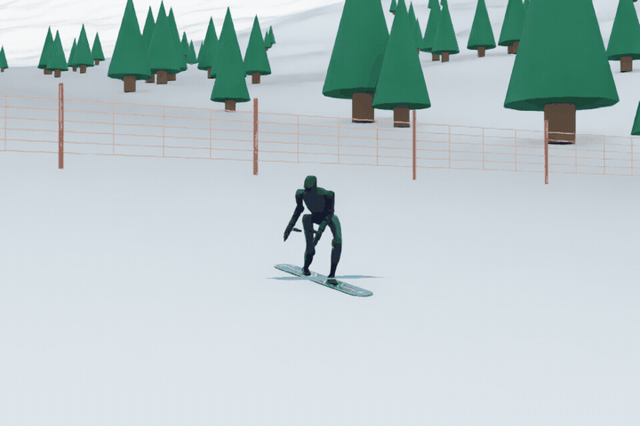
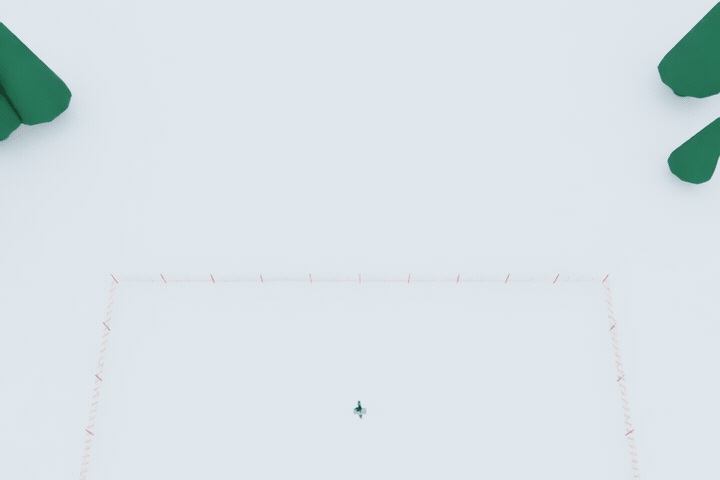

<p align="center">
  <h1 align="center">Learn2Carve</h1>
  <p align="center">
    <strong>A humanoid robot that learns aggressive snowboard carving with reinforcement learning</strong>
  </p>
  <p align="center">
    <a href="https://www.python.org/downloads/"></a>
    <a href="https://developer.nvidia.com/isaac/sim"></a>
    <a href="https://github.com/isaac-sim/IsaacLab"></a>
    
  </p>
</p>

---

<p align="center">
  <b>Author:</b> <a href="https://michae1park.github.io">Michael Park</a>
</p>

---

## Overview

Learn2Carve teaches a humanoid robot to ride a snowboard down a slope and lay it over on its edge, drawing a thin S
line. The snow, the board and their interaction are modelled from scratch. The rider is a stock Unitree G1 with no
physical modifications: its real masses, joint limits and motor torque limits. It is trained with PPO in stages.

<div align="center">






</div>

## What it does

- **Models** the snow, the board and their interaction (glide, sidecut steering, edge grip).
- **Robot:** a stock Unitree G1 (29 DoF) within its real joint and torque limits, strapped to the board through bindings.
- **Reward:** designed to favor a high edge angle, a thin track and turns that finish across the hill.
- **Training:** PPO in stages in Isaac Sim, up to full S turns at ~57° edge angles, 6 linked turns per 100 m run.

## Models

| Doc | What |
|---|---|
| [Board](docs/BOARD_MODEL.md) | Geometry, sidecut, bindings |
| [Snow](docs/SNOW_MODEL.md) | Glide, sidecut steering, edge grip, validation |
| [Humanoid](docs/HUMANOID_MODEL.md) | Bodies, joints, drives, binding loop, stance |

## Training

| Doc | What |
|---|---|
| [RL training](docs/RL_TRAINING.md) | MDP, reward, staged PPO, results |

## Quick start

**Prerequisites**

- Ubuntu 24.04
- GPU VRAM 16 GB+
- Python 3.12+, `git`, `curl`
- About 30 GB of disk for Isaac Sim

**Installation**

```bash
git clone https://github.com/michae1park/learn2carve.git
cd learn2carve
scripts/install.sh   # Isaac Sim 6.1 + Isaac Lab + skrl, into .venv-sim
```

**Run locally**

```bash
# Watch the trained G1 carve
scripts/py playground/snowboard/play.py saved/g1/chain/07_stage7_g1_7065_finish60

# ...with the live stream (Isaac Sim viewport)
scripts/py playground/snowboard/play.py saved/g1/chain/07_stage7_g1_7065_finish60 --livestream 2 --follow

# Train: stage 2 from scratch, then stages 3-7, each warm-started from the last
scripts/py playground/snowboard/train.py --stage stage2_g1_7065 --set robot=g1
scripts/py playground/snowboard/train.py --stage stage3_g1_7065 --set robot=g1 --init_from logs/playground/snowboard/<stage 2 run>
scripts/py playground/snowboard/train.py --stage stage4_g1_7065_edge --set robot=g1 --init_from logs/playground/snowboard/<stage 3 run>
```
