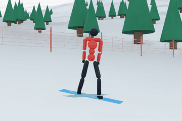
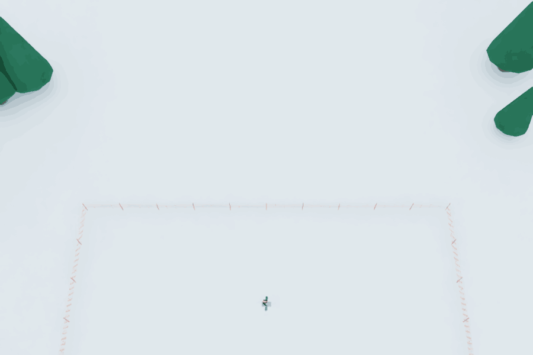
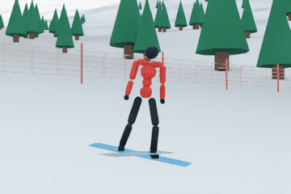
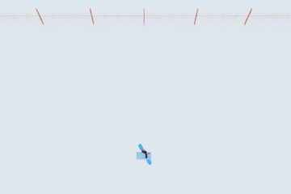
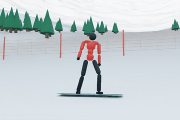
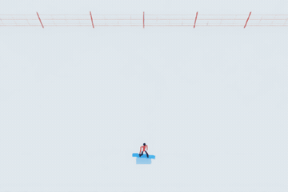

# learn2carve

### Demo: snowboard playground (plain RL, no demo clip yet)

<table>
  <tr><th></th><th>Front</th><th>Top</th></tr>
  <tr>
    <th>Carve</th>
    <td></td>
    <td></td>
  </tr>
  <tr>
    <th>Skid</th>
    <td></td>
    <td></td>
  </tr>
  <tr>
    <th>Side slip</th>
    <td></td>
    <td></td>
  </tr>
</table>

<em>Follow cameras on one evaluation run each, real time. Blue = the snow the board sweeps (wider = more sideways
slip). Recorded with <code>playground/snowboard/play.py &lt;run&gt; --record docs/demo/&lt;task&gt;</code>; see
<a href="playground/snowboard/README.md">playground/snowboard</a>.</em>

| Doc | What |
|---|---|
| [Overview](docs/OVERVIEW.md) | Pipeline, stages, layout, stack |
| [Humanoid model](docs/HUMANOID_MODEL.md) | Bodies, joints, drives, binding loop, stance |
| [Board model](docs/BOARD_MODEL.md) | Geometry, sidecut, bindings |
| [Snow model](docs/SNOW_MODEL.md) | Glide, sidecut steering, edge grip, validation |
| [RL training](docs/RL_TRAINING.md) | MDP, reward, PPO, learning curves |
