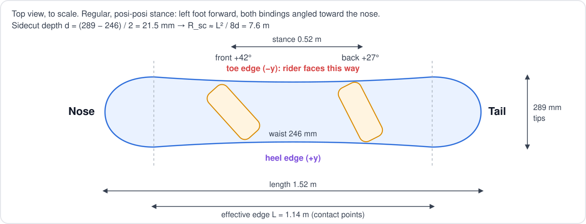
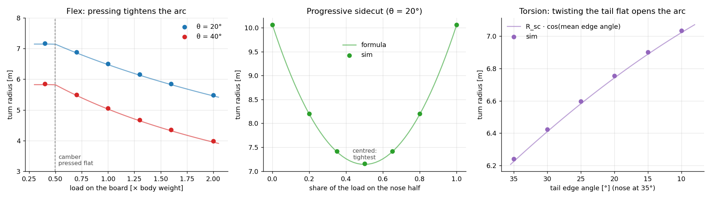

# Board model

The board is a real 152 cm all-mountain board, authored onto the humanoid at spawn as one rigid link
(`envs/rider.py::_author_board`).

- **Physics:** PhysX sees only a thin box that touches frictionless snow. Everything the board's *shape* does on snow
  (sidecut, edge grip) lives in the [snow model](SNOW_MODEL.md).
- **Looks:** the round tips, stripes and chevrons are visual only (no collision, no mass).
- **Scale:** the board is not scaled with the rider (the humanoid is scaled to 1.65 m).
- **Knobs:** `envs/physical.yaml` → `board`, `rider`. SI units.

## 1. Geometry

| Parameter | Value | Used for |
|---|---|---|
| Length | 1.52 m | Collision box |
| Waist width $w$ | 246 mm | Collision box, board lift on edge (`w/2 · sin θ`) |
| Tip width | 289 mm | Sidecut depth |
| Effective edge $L$ | 1.14 m | Sidecut radius, yaw-torque cap |
| Thickness | 8 mm | Collision box |
| Mass | 2.7 kg | Rigid body |

**Sidecut radius.** The edge between the two contact points is an arc of depth $d$:

$$d = \frac{w_{\text{tip}} - w_{\text{waist}}}{2} = 21.5\ \text{mm} \qquad R_{sc} \approx \frac{L^2}{8d} = \frac{1.14^2}{8 \times 0.0215} = 7.6\ \text{m}$$

The real board's progressive sidecut (10.7 / 6.8 / 10.7 m nose / waist / tail) is replaced by this one radius.

## 2. Frames and edges

| Axis | Points to |
|---|---|
| $x$ | Nose |
| $y$ | Heel edge |
| $z$ | Up, out of the base |

Edge angle $\theta > 0$: rolled about $+x$ so the **toe edge** ($-y$) digs in. Toe edge turns clockwise (riding nose
first), heel edge counter-clockwise.

## 3. Bindings

| Binding | Foot | Position $x$ | Angle $\alpha$ | Toe direction |
|---|---|---|---|---|
| Front | Left | $s + b/2 = +0.265$ m | +54° | yaw $\alpha - 90° = -36°$ |
| Back | Right | $s - b/2 = -0.295$ m | +45° | yaw $-45°$ |

**Regular, posi-posi stance:** left foot forward, and both bindings angled toward the nose (+54° / +45°), the forward
stance used for carving. Not duck (front +, back −). Stance width $b = 0.56$ m, setback $s = -15$ mm (toward the
tail). The picture shows the nose on the left.

`envs/physical.yaml` holds the same values (`binding_angles_deg=[54, 45]`, `stance_width=0.56`); the stance file is
`stance_54_45_squat4.yaml` from `scripts/make_stance.py`.

Both feet are welded to the board: the front binding is a tree joint, the back one a loop-closing constraint (see
[humanoid model §3](HUMANOID_MODEL.md#3-board-binding)).

## 4. Two-half board (opt-in, not used in the demo)

`--set board_flex=true` splits the board into **two rigid halves** (nose, tail) joined at the centre by a spring joint
the policy can't drive. The demo rides the rigid board of §1; this extension is validated against the snow model but
never trained on.

| DoF | Spring | Rest | Effect |
|---|---|---|---|
| `board_flex:0` roll | Torsion, 5 N·m/° | 0 | Nose and tail can edge differently |
| `board_flex:1` pitch | Bend, set so $N_c = 330$ N ($\approx \tfrac{1}{2}mg$) presses it flat | $-\varphi_0$ (5 mm camber) | Unloaded, only the tips touch |

Each half glides and grips on its own edge angle and load. Steering is one arc for the whole board, with four effects
on top of the rigid-board sidecut:

| Effect | Formula | Result |
|---|---|---|
| **Camber** | $c = 1 + q_{\text{bend}}/\varphi_0$, $\varphi_0 = 4h/L$ | No sidecut until the load presses the board flat |
| **Progressive sidecut** | $R(s) = R_{sc} + (R_{\text{tip}} - R_{sc})\,s^2$ | 7.6 m centred, 10.7 m at a tip ($s$ = nose share − tail share) |
| **Torsion** | $\bar\theta = \sum_i w_i\theta_i$, $w_i = N_i/N$ | The arc follows the load-weighted edge angle |
| **Flex** | $(N - N_c)_+\,\frac{L}{6\,EI}\sin\lvert\bar\theta\rvert$, $EI = 1500$ N·m² | Load beyond $N_c$ tightens the arc |

$$\kappa = \frac{c}{R(s)\cos\bar\theta} + (N - N_c)_+\,\frac{L}{6\,EI}\,\sin\lvert\bar\theta\rvert$$

### Validation (`scripts/validate_board.py`)

| Check | Sim / formula |
|---|---|
| **Flex**: radius vs load (θ = 40°) | 5.85 / 5.82 m at 0.4 mg, 3.99 / 3.95 m at 2 mg |
| **Progressive sidecut**: radius vs centre of pressure (θ = 20°) | 7.15 / 7.14 m centred, 10.06 / 10.05 m all on one half |
| **Torsion**: radius vs tail edge (nose 35°) | 6.24 / 6.23 m untwisted, 7.03 / 7.02 m with the tail at 10° |

## Not modelled (two-half board)

| Gap | Effect |
|---|---|
| Continuous flex | Two segments, one hinge: no bending within a half |
| Reverse camber on snow | A rigid half can't sink into the snow: flex beyond flat is analytic, not geometric |
| Snow deformation | Hardpack only: no edge penetration that grows with load |
