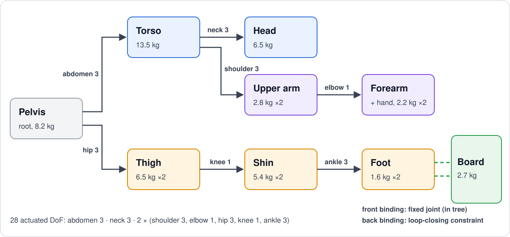

# Humanoid model

The rider is Isaac Lab's **28-DoF AMP humanoid** (`humanoid_28.usd`, capsule bodies), scaled to a 65 kg rider and
bound to the board as one articulation (`envs/rider.py`, `envs/carve_env.py`). PhysX simulates it; the policy only
sets joint targets. Knobs: `config.yaml` → `rider`. SI units; angles in ° unless marked rad.



## 1. Bodies

| Body | Mass [kg] | Body | Mass [kg] |
|---|---|---|---|
| Pelvis (root) | 8.17 | Thigh ×2 | 6.45 |
| Torso | 13.47 | Shin ×2 | 5.38 |
| Head | 6.53 | Foot ×2 | 1.59 |
| Upper arm ×2 | 2.78 | Forearm ×2 | 1.72 |
| Hand ×2 | 0.49 | **Board** | 2.70 |

**Total 67.7 kg.** Centre of mass in stance: **0.86 m** above the board.

The stock humanoid is ~36 kg. Masses, inertias and joint gains are all scaled by the same factor, so the dynamics keep
their shape at the new weight:

$$k = \frac{m_{\text{rider}}}{\sum_i m_i} = \frac{65}{35.7} = 1.82 \qquad m_i \leftarrow k\,m_i,\quad I_i \leftarrow k\,I_i,\quad (K_p, K_d) \leftarrow k\,(K_p, K_d)$$

## 2. Joints and drives

Spherical joints are three revolute axes ($x, y, z$); knees and elbows are hinges. Every joint is a stiff PD
position drive (implicit in PhysX):

$$\tau_j = K_p\,(q_j^* - q_j) - K_d\,\dot q_j$$

| Joint | DoF | Range (x / y / z) | $K_p$ | $K_d$ |
|---|---|---|---|---|
| Abdomen | 3 | ±60 / −60…90 / ±50 | 62 537 | 6 254 |
| Neck | 3 | ±50 / −40…60 / ±45 | 5 211 | 521 |
| Shoulder ×2 | 3 | −180…45 / −180…60 / ±90 | 20 846 | 2 085 |
| Elbow ×2 | 1 | −160…0 | 15 634 | 1 563 |
| Hip ×2 | 3 | −60…15 / −140…60 / −60…35 | 31 268 | 3 127 |
| Knee ×2 | 1 | 0…160 | 31 268 | 3 127 |
| Ankle ×2 | 3 | ±30 / ±55 / ±40 | 20 846 | 2 085 |

Gains are as reported by Isaac Lab after scaling. Joint velocity is capped at 100 rad/s.

## 3. Board binding

Both feet are welded to the board. A tree can't hold a loop, so the two bindings are split:

| Binding | Joint | Role |
|---|---|---|
| Front (left foot) | Fixed joint, **in the articulation tree** | Board is a child link of the left foot |
| Back (right foot) | Fixed joint, **excluded from the articulation** | Loop-closing constraint, solved iteratively |

The loop needs a converged solver: **32 position / 4 velocity iterations** at 120 Hz.

| Solver | Result |
|---|---|
| 4 / 0 (upstream) | Rider folds at the ankles, tips over standing still |
| 16 / 4 | Hips and ankles still sag ~0.05 rad |
| **32 / 4** | Within 0.02 rad, ~22% slower than 16 / 4 |

## 4. Stance (`scripts/make_stance.py`)

The default pose $q^{\text{stance}}$ is *found by simulation*, not hand-set: the pelvis and board are welded to the
world at the target poses, the binding constraints pull the feet onto the board, and the drives settle. The result
closes both loops exactly and is saved to `envs/assets/stance.yaml`.

| Setting | Value |
|---|---|
| Stance | Regular (left foot forward), facing the toe edge |
| Hip height | 0.80 m above the board top |
| Pelvis open | 20° from the toe edge toward the nose |
| Knees (front / back) | 46° / 41° bent |

## 5. Actions → joint targets

$$q^* = \operatorname{clip}\!\left(q^{\text{stance}} + 0.25 \cdot \tfrac{1}{2}(q^{\max} - q^{\min}) \cdot a,\ q^{\min},\ q^{\max}\right) \qquad a \in [-1, 1]^{28}$$

The policy reaches **±25% of each joint's half-range** around the stance. 50% (the upstream value) flails and falls.

## 6. New rider (opt-in, `--set`)

Each change is a flag on `CarveEnvCfg`; the defaults are the baseline above.

| Flag | Change |
|---|---|
| `thoracic=true` | **Second spine joint.** The torso splits into a lumbar segment (4.4 kg) and a chest (12.6 kg) joined by a 2-DoF thoracic joint, `thorax:0` roll (±40°) and `thorax:1` pitch (−40…60°). Neck and shoulders move to the chest. **30 DoF** |
| `compliant_drives=true` | **Per-group stiffness** instead of one uniform, very stiff drive (damping follows, keeping each joint's damping ratio) |
| `neck_stiffness_scale=0.5` | Softer neck: the head moves instead of being held rigid |
| `spine_damping_scale=2` | Extra damping on abdomen + thorax: no torso jerks |
| `pelvis_mass_frac=0.2` | **Heavy root**: the pelvis carries 20% of the mass (stock 12.6%), the rest scale down to keep 65 kg |
| `physics_hz=240`, `solver_iterations=[16,4]` | Physics at 240 Hz (decimation 8), fewer solver iterations |

**Spine:**

```
pelvis ─abdomen (3)─ lumbar ─thorax (2)─ chest ─┬─ neck (3) ─ head
                                                └─ shoulders (3) ─ arms
```

**Compliant drives** (stiffness × scale, on top of the mass scaling):

| Group | Hip | Knee | Ankle | Abdomen | Thorax | Shoulder | Elbow | Neck |
|---|---|---|---|---|---|---|---|---|
| Scale | 1.0 | 1.0 | 0.7 | 0.35 | 0.35 | 0.3 | 0.3 | 0.4 (× 0.5 neck scale) |

Legs carry the body and stay stiff; the spine, arms and neck give, as a human's do.

### Checks (`scripts/rider_check.py`: stance held 3 s, zero action)

| Model | Worst sag | Falls | Step time |
|---|---|---|---|
| Baseline: 120 Hz, 32 / 4 | 0.014 rad | 0% | 1.0× |
| 240 Hz, 8 / 4 | 0.055 | 0% | 1.1× |
| 240 Hz, 12 / 4 | 0.023 | 0% | 1.2× |
| **240 Hz, 16 / 4** | **0.013** | 0% | — |
| 120 Hz, 12 / 4 | 0.044 | **100%** | 0.6× |
| **Full new rider + two-half board**, 240 Hz, 16 / 4 | **0.017** (board bend) | 0% | 2.0× (training throughput) |

- **Velocity iterations don't help** (12 / 4 and 12 / 6 are identical).
- **The split torso first sagged 0.15 rad and fell.** The chest sphere overlaps the pelvis's upper-waist sphere by
  ~3 cm; once the lumbar segment sat between them they were no longer neighbours, so PhysX pushed them apart every
  step. The pair is now filtered.

## Known gaps

| Gap | Effect |
|---|---|
| **No torque limits** (effort limit = float max) | Joints are stronger than a human's: balance is easier than it should be |
| No wrists, no toes | Fine in boots; hands can't counter-balance finely |
| CoM not observed | The policy must infer its balance from body pose |
