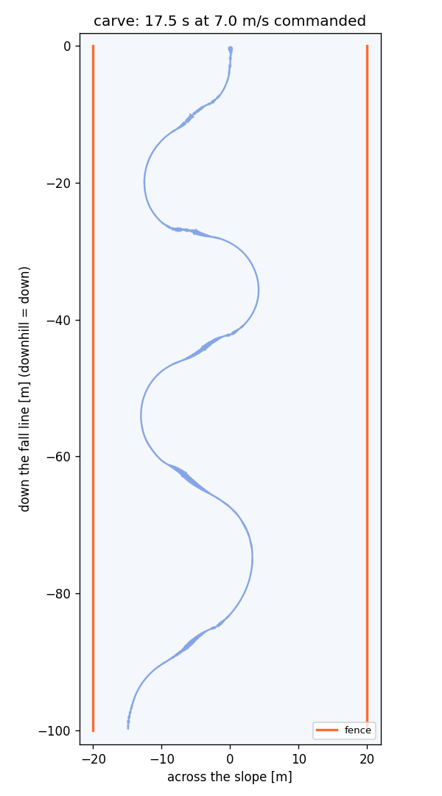

# RL training

One env (`playground/snowboard/env.py`, task `carve`) and plain **PPO** (`skrl`). The rider learns linked carved
turns by **tracking a commanded edge angle**: a heel ↔ toe edge command plays the part of the turn planner, and the
policy learns to put the board on that edge and stay up. Training runs in **stages**, each warm-started from the
last. No demonstration and no motion data. Knobs: `SnowboardEnvCfg` (`--set key=value`), the stage scripts in
`scripts/`, `playground/snowboard/ppo.yaml`. SI units; angles in ° unless marked rad.

## 1. The task: follow the edge command

**No line is laid on the snow.** Each step the env commands a signed edge angle $\theta^*$ (heel $< 0$, toe $> 0$);
the board's sidecut turns whatever edge the rider holds, so a command that alternates heel ↔ toe draws an S. The
policy only has to learn the body: how to get the board onto that edge, hold it and change it without falling.

| Quantity | Definition |
|---|---|
| Edge angle $\theta$ | Board roll relative to the snow surface ([snow model](SNOW_MODEL.md)) |
| Path heading $\psi$ | $\mathrm{atan2}(v_y, v_x)$: travel direction, 0 = straight down the fall line. A heel edge turns $\psi$ up, a toe edge down |
| Slip angle $\beta$ | Angle between the board's axis and its travel; ~0 when carving |
| Balanced edge | $\sin\theta = v^2 / (g\cos\alpha \cdot R_{sc})$: the edge a rider can hold at speed $v$. 20° at 5 m/s, 41° at 7 m/s on a 9° slope |

**Why a command and not a reward for turning.** Five runs that rewarded turns, speed and carving (with a guide S to
start from, then without) all converged to holding one deep edge into the fence. Tracking a timed edge command gives
the S directly. A planar double-pendulum sandbox (`scripts/pendulum_rl.py`) confirmed first that edge-command
tracking plus a fall penalty is learnable: it linked an edge change every 2 s at ±45–50°, and counter-angulation
emerged on its own.

### The edge command

| Mode | Command |
|---|---|
| Timed (stage 2) | $\theta^*(t) = A \mathrm{clip}\big(1.8 \sin(2\pi t / T + \varphi),\ -1,\ 1\big)$: a trapezoid heel → flat → toe |
| **Heading** (stage 3) | Hold one edge at $\pm A$ until the turn has come round, $\psi$ past $\pm 40°$ across the hill, then ramp through flat to the other edge over 0.6 s. Never sooner than 1 s, never later than 4 s on one edge |
| Centring (stage 3) | The 40° switch heading moves 2° per metre off the piste centre (capped at ±10°): the turn back toward the centre runs longer, the one away from it ends sooner, so the S stays between the fences |

**Curriculum.** The amplitude $A$ and period $T$ step from easy to hard by a level in $[0, 1]$ that rises while the
running edge error is below 12° and falls above 24°. The policy sees the command now, +0.3 s and +0.6 s.

## 2. Stages

| Stage | Script | Start | Episode | Slope | Command | Speed |
|---|---|---|---|---|---|---|
| 1. Hold a carve | `train_stage1_carve.sh` | Balanced on an edge | 4 s | 7° | Hold the balanced edge | 5–7.5 m/s |
| **2. Change edges** | `train_stage2_transition.sh` | Balanced on an edge (80% toe), 50% from recorded toe-carve states | 10 s | 7° | Timed, ±15 → 30°, $T$ 6 → 4 s | 4–5.5 m/s |
| **3. Full S** | `train_stage3_full_s.sh` | Flat, heading within ±20° of the fall line, 4–5.5 m/s; 30% recorded states | 20 s | 9° | Heading (40°) + centring, ±25 → 45° | free (eval mean 7.9 m/s) |

**Stage 1 is skipped.** Stage 2 warm-started from stage 1 never learned to change edges (it kept holding the edge
stage 1 taught); stage 2 from scratch learns the hold anyway, because its episodes start in a carve. The demo runs
stage 2 from scratch, continues it, then warm-starts stage 3 from it.

**Recorded-state starts** (`rsi_frac`). During training the env records rider states from more than 3 s into an
episode on the toe edge (the low, bowed carve where the switch to the heel is hardest) and restarts a share of
episodes from them, with the command at the toe peak. Without them every episode started tall, the only pose the
policy had learned to switch from.

## 3. MDP

| | |
|---|---|
| **Observation** (140) | Humanoid: joint positions and velocities, torso height, orientation, velocities, hands and feet relative to the root (AMP layout) |
| | Board: $\theta$, $v_\parallel$, $v_\perp$, yaw rate, $N/mg$, grip usage |
| | Last action, and the two synergy actions |
| | Task (19): speed, $\psi$, $\beta$, board yaw, position between the fences, turn state, the edge command now / +0.3 s / +0.6 s |
| **Action** (30) | 2 synergy actions (edge, lean) + 28 joint residuals, 30 Hz, smoothed: see [humanoid model §5](HUMANOID_MODEL.md#5-actions--joint-targets) |
| **Fall** | Torso tilted > 95° (`lying_deg`; a toe carve bows the torso 55–70°), pelvis < 0.12 m above the board, pelvis < 0.15 m above the snow, board past 85° of edge, or riding tail first ($\lvert\beta\rvert > 100°$ above 2 m/s) |
| **Fence** | Board past ±20 m across the slope; ends the episode like a fall |
| **Time-out** | End of the episode (stage length above) |

## 4. Reward

Each step, with $\Delta t = 1/30$ s, $e = \theta - \theta^*$:

$$r = \Delta t \sum_i w_i\, r_i \;+\; w_{\text{fall}}\,\mathbb{1}[\text{fall or fence}]$$

| Term | $r_i$ | $w_i$ |
|---|---|---|
| **Edge command** | $e^{-(e/\sigma)^2}$, $\sigma$ = 30° (stage 1: 12°), × 0 while the board is flat ($\lvert\theta\rvert$ < 10°, full from 20°): a flat board never pays | 30 |
| **Edge side** | +1 on the commanded side, −1 on the other ($\lvert\theta^*\rvert$ > 10°, $\lvert\theta\rvert$ > 3°): starting the switch pays before the angle matches | 20 |
| **Pose reference** | $e^{-((\phi_{\text{legs}} - 1.15\theta^*)/15°)^2}\, e^{-((\phi_{\text{CoM}} - 0.77 \cdot 1.15\theta^*)/15°)^2}$: legs lean past the edge, centre of mass lean less (angulation), from the pendulum model; 0 near flat | 10 |
| **Rise** | while $\lvert\theta^*\rvert$ < 8°: clip((pelvis height − 0.35 m) / 0.2 m): come up through the edge change | 30 |
| **Tilt** | clip((torso tilt − 50°) / 20°): a bow past ~65° can't get back to the heel | −10 |
| **Hand grab** | clip(1 − d / 1.2 m), $d$ the inside hand to its grab point: heel turn, right hand → toe edge at the front foot; toe turn, left hand → heel edge at the back foot. Counter-angulation for higher edges. Stage 2 used $e^{-(d/0.6\,\text{m})^2}$ at weight 5 | 10 |
| **Fall** | Once, a fall or a fence | −50 |

Nothing rewards speed, staying alive, posture or style: survival pays only through the edge terms it allows.

**Lessons (each cost at least one run):**

| Try | What happened | Fix |
|---|---|---|
| Turn, speed and carve rewards, guide S | Every run converged to one deep edge held into the fence | Edge-command tracking |
| Edge command, alive reward on | Rode straight and flat: being alive paid more than turning | No alive reward; a flat board never pays |
| Edge command with a side-slip allowance | Slid flat sideways to keep speed and hit the fence | Edge reward requires an edge |
| $\sigma$ = 12° only | Held the old edge: crossing flat paid nothing, so starting a switch only cost | $\sigma$ = 30° and the edge-side term |
| Fall −10 | Switched edges but fell after 2–3 s: a fall cost less than 2 s of edge reward | −50 |
| Command ±50° at 4–5.5 m/s | 75% of falls were "lying": a 50° edge can't balance below ~7 m/s | Stage 2 at ±15 → 30°; speed and amplitude rise together in stage 3 |
| Lying = torso > 80° | Legitimate deep toe carves were counted as falls | 95° |
| Toe → heel never learned | The board could not leave a low toe carve under any forced action: the torso twist sat at its limit | Rider rebuild ([humanoid model §6](HUMANOID_MODEL.md#6-rider-options-carveenvcfg-flags---set)) |
| Boots added | Edge and lean actions flipped every step, the rider shook | Action smoothing |
| Grab as a Gaussian, $\sigma$ = 0.25 / 0.6 m | The toe-turn hand sat 0.9 m away with no pull | Linear in distance to 1.2 m |
| Edge change on a timer | Turns stopped short or drifted toward a fence | Heading switch with centring |

## 5. PPO

| Setting | Value |
|---|---|
| Envs | 2048 in parallel |
| Rollout | 48 steps (1.6 s, an edge change fits) × 2048 = **98k samples per update** |
| Update | 5 epochs × 8 mini-batches |
| Training | 16 000 steps per env per run (~26 min on one GPU) |
| Networks | Policy and value: separate MLPs, 512-256-128, ELU |
| Policy | Gaussian, initial $\sigma_a = e^{-1}$, capped at $e^{-0.3}$ (it had grown to ~6 against clipped actions) |
| Discount, GAE | $\gamma = 0.995$ (~6.7 s, more than one S), $\lambda_{\text{GAE}} = 0.98$ |
| Learning rate | $10^{-3}$, KL-adaptive (target KL 0.01) |
| Clipping | Ratio 0.2, value 0.2, grad norm 1.0 |
| Entropy bonus | 0.003 |
| Warm start | `--init_from <run or saved/ folder>`; the exploration noise is reset |

## 6. Evaluation (`playground/snowboard/play.py`)

A deterministic policy (mean action) rides fixed runs: piste centre, straight down, 100 m long, no recorded-state
starts, and the edge command held at the level training ended on (`edge_cmd_level_init=1`, `edge_cmd_level_fixed`).
Each run prints one line of stats; the longest is saved as `trail.png` + `ride.csv` (edge, command, slip, torso tilt,
pelvis height per step). `--record DIR` films it for the README.

Diagnostics:

| Script | Shows |
|---|---|
| `scripts/switch_test.py` | From a low toe carve, the command flips to the heel: does the policy (or a forced edge / lean action) reach the heel edge? |
| `scripts/jitter_probe.py` | Which joints shake: velocity and step-to-step velocity change per joint, action change per step |
| `scripts/grab_probe.py` | How close each inside hand gets to its grab point, per turn side |

## 7. Results (`saved/04_stage3_tighter`)

Stage 3 plus `edge_cmd_heading_deg=40 edge_cmd_center_max_deg=10` (the script's defaults are 50° and ±25°),
warm-started from `saved/03_stage3_centred`, 16 000 steps.

| | Eval (90 s) |
|---|---|
| Runs reaching the end of the course | **5 of 5**, in 15–17.5 s |
| Turns | 4–5 per 100 m run (03: 3–4) |
| Edge (toe / heel), longest run | mean 43° / 38°, max 57° / 48° |
| Slip | ~3°: a clean carve, a thin line |
| Speed, longest run | 3.9–10.4 m/s, mean 7.9 |
| Track | within ±15 m of the centre (fences at ±20 m) |

**Open.** The board skids briefly through each edge change. The earlier run (`03_stage3_centred`, switch at 50°) overshot,
with headings of 56–91° across the hill at the switch, aimed at 50°.
