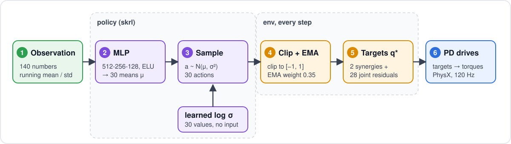
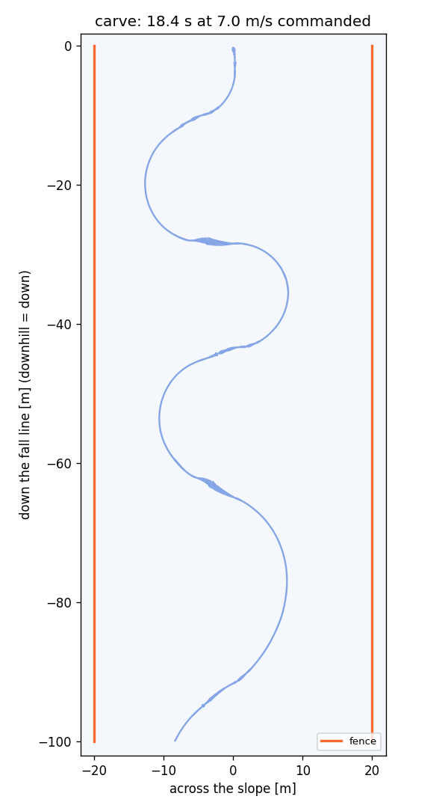

# RL training

A simulated rider learns to **carve**: link clean, high-edge-angle turns into an S down a fenced trail. One env
(`playground/snowboard/env.py`) and plain **PPO** (`skrl`), no demonstration and no motion data. SI units; angles in °
unless marked rad.

## Overview

### What the rider learns, in stages

Carving is too much to learn at once, so training is split into stages, each warm-started from the last. The order
follows what failed when it was tried all at once.

| Stage | The rider learns to | Why this order |
|---|---|---|
| 1. Hold a carve | Balance on one edge | Dropped: the policy that held an edge never learned to leave it |
| **2. Change edges** | Flip from the toe edge to the heel edge and back, again and again, without falling. The flips come on a fixed clock, one every 2–3 s | The hard move, and the one every later stage reuses |
| **3. Full S** | Link the flips into an S, with the edge change triggered by the turn itself, and stay between the fences | Stage 2's fixed clock ignores where the board is, so the rider drifts into a fence. Here the turn itself decides when to flip |
| **4. Tighter turns** | End each turn sooner, without the overshoot | Stage 3's turns swing past their target |

Details and results per stage: [§5](#5-stages).

### What a good carve looks like

A carve is the board following the arc of its own sidecut, with no sideways skid. You can recognize it by a **high edge angle**
(the board rolled well over onto its edge) with almost no **slip** (the board points where it travels), which draws a
thin line in the snow.

| | Skidded turn | Carved turn | Trained rider |
|---|---|---|---|
| Edge angle | low | 40°+ | toe 43° / heel 38° mean, up to 57° (stage 4) |
| Slip | large | ~0 | ~3° |
| Track | smeared | thin line | thin S, 4–5 turns per 100 m |

A high edge angle needs speed (a 40°+ edge only balances above ~7 m/s, [§1](#1-the-edge-command-a-target-the-rider-tracks)),
which is why the slope steepens and the target angles rise together as the stages go on.

### Three ideas that make it work

| Idea | In short |
|---|---|
| **Track a command, don't reward turning** | The env gives the rider a target edge angle each step. Rewards for turning, speed and carving all ended with one deep edge held into the fence; a target that alternates heel ↔ toe draws the S directly ([§1](#1-the-edge-command-a-target-the-rider-tracks)) |
| **Start from a good pose** | The rider's neutral pose is a snowboarder's base position: a squat, knees bent, over the board. Every action is a small change around it, and zero action holds it. Stage 2 episodes start already on an edge, so a carve does not have to be built from standing ([humanoid model](HUMANOID_MODEL.md#4-stance-scriptsmake_stancepy)) |
| **Add a hint for balance** | A reward for reaching the inside hand toward the board edge (counter-angulation), which is what human riders learn for balance at high edge angles ([§3](#3-reward)) |

### One training step


The env gives the rider a target edge angle $`\theta^\ast`$ (the *edge command*). The policy sees the body state and
$`\theta^\ast`$, and outputs joint targets. The body tips the board, the [snow model](SNOW_MODEL.md) turns that edge into a
turn, and the reward measures how close the edge came to $`\theta^\ast`$. PPO improves the policy from 2048 riders in
parallel. The policy does not plan a path: that lives in the command generator ([§1](#1-the-edge-command-a-target-the-rider-tracks)).
The policy learns the body.

## 1. The edge command: a target the rider tracks

**No line is laid on the snow.** Each step the env commands a signed edge angle $`\theta^\ast`$ (heel $`< 0`$, toe $`> 0`$).
The board's sidecut turns whatever edge the rider holds ([snow model §2](SNOW_MODEL.md#2-sidecut-steering)), so a
command that alternates heel ↔ toe draws an S. The policy only has to learn the body: get the board onto that edge,
hold it, and change it without falling, in a posture it can switch from (the pose, rise and grab terms of §3).

| Quantity | Definition |
|---|---|
| Edge angle $`\theta`$ | Board roll relative to the snow surface ([snow model](SNOW_MODEL.md)) |
| Path heading $`\psi`$ | $`\mathrm{atan2}(v_y, v_x)`$: travel direction, 0 = straight down the fall line. A heel edge turns $`\psi`$ up, a toe edge down |
| Slip angle $`\beta`$ | Angle between the board's axis and its travel; ~0 when carving |
| Balanced edge | The edge a rider can hold at speed $`v`$ on a slope $`\alpha`$ (formula below) |

The sidecut radius is $`R_{sc}`$ = 7.6 m ([board model §1](BOARD_MODEL.md#1-geometry)). The balanced edge is

```math
\sin\theta = \frac{v^2}{g\cos\alpha \cdot R_{sc}}
```

which is 20° at 5 m/s and 42° at 7 m/s on a 9° slope. A 40°+ edge only balances above ~7 m/s, so edge angle and speed
have to rise together.

**Why a command and not a reward for turning.** Five runs that rewarded turns, speed and carving (with a guide S to
start from, then without) all converged to holding one deep edge into the fence. Tracking an edge command gives the S
directly. A planar double-pendulum sandbox (`scripts/pendulum_rl.py`) confirmed first that edge-command tracking plus
a fall penalty is learnable: it linked an edge change every 2 s at ±45–50°, and counter-angulation emerged on its own.

**How the command is made.** Stage 2 uses a clock (the command swings heel ↔ toe on a fixed period). Stages 3–4 use a
**closed-loop** rule: the command reads the travel heading $`\psi`$ and the position across the trail, so the turn planner
is hand-built into the env, and the policy sees $`\psi`$, its position and the command 0.3 s and 0.6 s ahead
([§2](#2-mdp)). Both generators and the curriculum are in [§5](#5-stages).

## 2. MDP



### What the policy sees and does

The 140 numbers the network reads, the 30 numbers it outputs, and the processing that turns them into joint targets:

| | Group | Part | Size | Notation | Content |
|---|---|---|---|---|---|
| **Observation** (140) | Humanoid | Joint positions | 30 | $`q \in \mathbb{R}^{30}`$ | All joints (28 driven + 2 passive) |
|  |  | Joint velocities | 30 | $`\dot q \in \mathbb{R}^{30}`$ | Same joints |
|  |  | Torso height | 1 | $`h`$ | Root height above the snow |
|  |  | Torso orientation | 6 | $`(\mathbf{t},\ \mathbf{n})`$ | Root frame as tangent and normal vectors, 3 + 3 |
|  |  | Torso velocity | 3 + 3 | $`\mathbf{v},\ \boldsymbol{\omega}`$ | Linear and angular velocity |
|  |  | Hands and feet | 12 | $`\mathbf{p}_k - \mathbf{p}_{\mathrm{root}}`$ | Positions of the right hand, left hand, right foot and left foot relative to the root, in the slope frame (x, y, z each) |
|  | Board | Edge angle | 1 | $`\theta`$ | Roll relative to the snow |
|  |  | Velocity | 2 | $`v_\parallel,\ v_\perp`$ | Along and across the board |
|  |  | Yaw rate | 1 | $`\dot\psi_b`$ | Board rotation about the snow normal |
|  |  | Load | 1 | $`N/mg`$ | Normal force over body weight |
|  |  | Grip usage | 1 | $`u`$ | Edge grip used / available (capped at 5) |
|  | Previous action | Joint actions | 28 | $`a^{j}_{t-1}`$ | Last step's joint residuals |
|  |  | Synergy actions | 2 | $`s_{0,t-1},\ s_{1,t-1}`$ | Last step's edge and lean synergies |
|  | Task | Speed | 1 + 1 | $`v,\ v_{\mathrm{cmd}}`$ | Board speed and the episode's sampled speed command |
|  |  | Path heading | 2 | $`\sin\psi,\ \cos\psi`$ | Travel direction, 0 = fall line |
|  |  | Slip | 2 | $`\sin\beta,\ \cos\beta`$ | Board axis vs. travel |
|  |  | Board yaw | 2 | $`\sin\gamma,\ \cos\gamma`$ | Board heading |
|  |  | Position | 1 | $`y / W`$ | Across the trail, in half-widths of the fence |
|  |  | Turn state | 3 | side, swing, $`t_{\mathrm{turn}}`$ | Current turn side, its largest $`\lvert\psi\rvert`$ so far, time since the last turn (clipped at 10 s, ÷ 5) |
|  |  | Edge command | 3 | $`\theta^\ast(t),\ \theta^\ast(t{+}0.3),\ \theta^\ast(t{+}0.6)`$ | Now and 0.3 s, 0.6 s ahead |
|  |  | Unused | 4 | 0 | Kept so saved policies load |
| **Action** (30) | Synergy | Edge | 1 | $`\mu^{s_0} \to s_0`$ | Ankles and knees together, +1 toward the toe edge, −1 toward the heel |
|  |  | Lean | 1 | $`\mu^{s_1} \to s_1`$ | Abdomen side-bend (counter-angulation) |
|  | Joint residuals (28) | Abdomen | 3 | $`\mu^{\mathrm{abd}} \to a^{\mathrm{abd}}`$ | Spine twist, side-bend, bow; ±7.5% of the half-range |
|  |  | Neck | 3 | $`\mu^{\mathrm{neck}} \to a^{\mathrm{neck}}`$ | ±7.5% |
|  |  | Hips | 6 | $`\mu^{\mathrm{hip}} \to a^{\mathrm{hip}}`$ | 3 per leg; ±7.5% |
|  |  | Knees | 2 | $`\mu^{\mathrm{knee}} \to a^{\mathrm{knee}}`$ | Flexion only (the twist is passive); ±7.5% |
|  |  | Ankles | 6 | $`\mu^{\mathrm{ankle}} \to a^{\mathrm{ankle}}`$ | 3 per foot; ±7.5%, clipped to the boots' range |
|  |  | Shoulders | 6 | $`\mu^{\mathrm{sh}} \to a^{\mathrm{sh}}`$ | 3 per arm; **±50%** (the arms reach for the hand grab) |
|  |  | Elbows | 2 | $`\mu^{\mathrm{elb}} \to a^{\mathrm{elb}}`$ | **±50%** |
|  | Processing (not network outputs) | Std | 30 | $`\sigma = e^{\log\sigma}`$ | A learned parameter, not computed by the network: one number per action, the same in every state. Starts at 0.37, capped at 0.74, learned by gradient descent ([§4](#how-the-exploration-noise-σ-is-learned)) |
|  |  | Sample | 30 | $`a \sim \mathcal{N}(\mu, \sigma^2)`$ | Drawn by skrl: raw Gaussian sample around the network's means; continuous (not binned) |
|  |  | Clip | 30 | $`a \leftarrow \mathrm{clip}(a, -1, 1)`$ | Env: keeps every component in range |
|  |  | Smoothing | 30 | $`\tilde a_t = 0.65\,\tilde a_{t-1} + 0.35\,a_t`$ | Env: EMA on the new action, stops chatter |
|  |  | Joint target | 28 | $`q^\ast`$ | Env: stance pose + the smoothed action mapped to joint angles, clipped to the joint limits (equation below); held by the PD drives ([humanoid model §5](HUMANOID_MODEL.md#5-actions--joint-targets)) |

#### From the smoothed action to a joint target

The smoothed action has 30 components: 28 joint residuals
$`\tilde a_j`$ and 2 synergies $`\tilde s_0, \tilde s_1`$. Each joint's target is its stance angle, plus a scaled
residual, plus the synergy terms, clipped to the joint limits:

```math
q^\ast_j = \mathrm{clip}\Big(q^{\mathrm{stance}}_j \;+\; \underbrace{c_j\,\tfrac12\big(q^{\max}_j - q^{\min}_j\big)\,\tilde a_j}_{\text{joint residual}} \;+\; \underbrace{\tilde s_0\,\rho^{\mathrm{edge}}_j + \tilde s_1\,\rho^{\mathrm{lean}}_j}_{\text{synergies}} \;+\; \underbrace{[\tilde s_0]_+\,\rho^{\mathrm{toe}}_j}_{\text{toe extra}},\ \ q^{\min}_j,\ q^{\max}_j\Big)
```

| Term | Meaning |
|---|---|
| $`q^{\mathrm{stance}}_j`$ | The base position: zero action holds this pose ([humanoid model §4](HUMANOID_MODEL.md#4-stance-scriptsmake_stancepy)) |
| $`c_j`$ | Residual scale: $`0.3 \times 0.25 = 0.075`$ for the body joints (±7.5% of the half-range), **0.5** for the shoulders and elbows (±50%), so the arms can reach for the hand grab |
| $`\rho^{\mathrm{edge}}`$ | Per unit of $`\tilde s_0`$: ankles +0.5 rad, knees +0.6 rad. One number rolls the board onto its edge (+1 toe, −1 heel) |
| $`\rho^{\mathrm{lean}}`$ | Per unit of $`\tilde s_1`$: abdomen side-bend +0.9 rad (counter-angulation) |
| $`\rho^{\mathrm{toe}}`$ | Only when $`\tilde s_0 > 0`$ ($`[x]_+ = \max(x, 0)`$), per unit: knees +0.4 rad, hip pitch −0.3 rad. The toe edge comes from a squat |

Every $`\rho`$ is zero for the joints it does not list. Example: $`\tilde s_0 = +1`$ bends the knees by 0.6 + 0.4 = 1.0 rad
and pitches the hips by −0.3 rad; the ankle term (+0.5 rad) is clipped to the boots' range (−5° to +15°).

### When an episode ends

The episode ends on one of three conditions. They are not policy inputs or outputs: the env checks them every step and
resets that rider on its own (2048 riders reset independently).

| Ends as | Condition | Notation | Content | Effect |
|---|---|---|---|---|
| **Fall** (terminated) | Torso tilt | $`\phi_{\mathrm{torso}} > 95^\circ`$ | `lying_deg`; a toe carve bows the torso 55–70° | −50 once, return ends |
| | Pelvis above the board | $`h_{\mathrm{pelvis,board}} < 0.12`$ m | Sitting on the board | |
| | Pelvis above the snow | $`h_{\mathrm{pelvis,snow}} < 0.15`$ m | Down on the snow | |
| | Edge angle | $`\lvert\theta\rvert > 85^\circ`$ | Board on its side | |
| | Tail first | $`\lvert\beta\rvert > 100^\circ`$ and $`v > 2`$ m/s | Riding backwards | |
| **Fence** (terminated) | Position | $`\lvert y\rvert > W = 20`$ m | Board past the fence across the slope | Same as a fall |
| **Time-out** (truncated) | Episode length | $`t > T_{\mathrm{ep}}`$ | 10 s (stage 2), 20 s (stages 3–4) | No penalty |

How each ending enters the return (the −50 on a fall or fence, the bootstrap through a time-out) is in
[§4](#the-training-loop-in-plain-words).

### Rates: policy and physics

Two clocks run at once, and one is a multiple of the other: **one policy step contains 4 physics substeps.**

| | Policy step | Physics substep |
|---|---|---|
| Rate | 30 Hz | 120 Hz (4 × 30) |
| Length | 33.3 ms | 8.3 ms |
| Runs per policy step | once | 4 times |
| What happens | Read the observation, the network and sampling give an action, the action becomes a joint target $`q^\ast`$, the reward is computed | The PD drives pull each joint toward $`q^\ast`$, the snow model adds its forces, PhysX advances the bodies |

Within a policy step the target $`q^\ast`$ is **held fixed**: the policy does not act again until the 4 substeps are
done. The simulation does not stand still, though: at every substep the PD drives recompute their torques from the
joints' current angles, and the snow model recomputes its forces from the board's current motion.

The env requires the physics rate to be a multiple of the policy rate (here 4 × 30 Hz).

## 3. Reward

Each step the rider earns a weighted sum of six terms $`g_i`$, each between −1 and 1, plus a one-time penalty for falling.
With $`\Delta t = 1/30`$ s and the weights of stage 3:

```math
r = \Delta t\Big[\,30\,g_e + 20\,g_s + 10\,g_p + 30\,g_r - 10\,g_t + 10\,g_h\Big] - 50\ \mathbb{1}[\text{fall or fence}]
```

| Term | Pays for | Weight |
|---|---|---|
| **Edge command** $`g_e`$ | The board's edge angle $`\theta`$ close to the command $`\theta^\ast`$ | 30 |
| **Edge side** $`g_s`$ | Being on the commanded side (toe or heel), even before the angle matches | 20 |
| **Pose reference** $`g_p`$ | Legs and center of mass leaning the way a human carver's do (angulation) | 10 |
| **Rise** $`g_r`$ | Standing tall while the command is near flat: coming up through the edge change | 30 |
| **Tilt** $`g_t`$ | *Penalty* for bowing the torso too far | −10 |
| **Hand grab** $`g_h`$ | The inside hand reaching toward the board edge, for balance | 10 |
| **Fall** | *Penalty*, once, for a fall or crossing a fence | −50 |

### What the reward does and does not pay for

- **It pays for tracking the command** (edge command and edge side: 50 of the 100 points of positive weight) **and for
  the posture that makes a switch possible** (rise, pose reference and hand grab: 50 points).
- **There is no bonus for staying alive.** A rider earns only by being on an edge near the command, so surviving flat
  and upright pays nothing, and the −50 fall penalty makes the rider avoid the falls that would end its earning.
- **There is no reward for speed.** The speed comes from the slope ([§5](#5-stages)).

### The terms in detail

**Edge command.** With the error $`e = \theta - \theta^\ast`$ and $`\sigma = 30°`$:

```math
g_e = e^{-(e/\sigma)^2}\cdot\mathrm{ramp}\big(\lvert\theta\rvert;\ 10°,\ 20°\big)
```

The ramp is 0 below a 10° edge and 1 above 20°, so a flat board never pays. $`\sigma`$ is wide, so crossing flat toward the
new edge already earns something.

**Edge side.** $`g_s = \mathrm{sign}(\theta)\,\mathrm{sign}(\theta^\ast)`$: +1 on the commanded side of the board, −1 on the
other. It applies only when $`\lvert\theta^\ast\rvert > 10°`$ and $`\lvert\theta\rvert > 3°`$, and is 0 otherwise. It makes starting a
switch pay before the angle matches.

**Pose reference.** From the pendulum model: the legs should lean past the commanded edge and the center of mass less.
It is 0 when $`\lvert\theta^\ast\rvert < 10°`$.

$`\phi_{\mathrm{legs}}`$ and $`\phi_{\mathrm{CoM}}`$ are **not observed**: the env computes them from the simulator state,
for the reward only. Each is the angle, in the board's roll plane, of a point above the board away from the snow normal.
With $`\mathbf{p}`$ the positions of the board, the pelvis and the rider's center of mass:

```math
\phi_{\mathrm{legs}} = \mathrm{atan2}\big(\mathbf{d}_{\mathrm{legs}}\cdot\hat{\mathbf{t}},\ \mathbf{d}_{\mathrm{legs}}\cdot\hat{\mathbf{n}}\big) \qquad \phi_{\mathrm{CoM}} = \mathrm{atan2}\big(\mathbf{d}_{\mathrm{CoM}}\cdot\hat{\mathbf{t}},\ \mathbf{d}_{\mathrm{CoM}}\cdot\hat{\mathbf{n}}\big)
```

```math
\mathbf{d}_{\mathrm{legs}} = \mathbf{p}_{\mathrm{pelvis}} - \mathbf{p}_{\mathrm{board}} \qquad \mathbf{d}_{\mathrm{CoM}} = \mathbf{p}_{\mathrm{CoM}} - \mathbf{p}_{\mathrm{board}} \qquad \mathbf{p}_{\mathrm{CoM}} = \frac{\sum_i m_i\,\mathbf{p}_i}{\sum_i m_i}
```

- $`\hat{\mathbf{n}}`$ is the snow normal. $`\hat{\mathbf{t}}`$ lies in the snow plane, perpendicular to the board's long axis, and points toward the toe edge.
- The center of mass is the mass-weighted mean of the rider's bodies, with the board left out.
- $`\phi > 0`$ is a lean toward the toe edge, the same sign as $`\theta`$ and $`\theta^\ast`$. A point straight above the board along the snow normal has $`\phi = 0`$.

```math
g_p = \exp\left(-\left(\frac{\phi_{\mathrm{legs}} - 1.15\,\theta^\ast}{15°}\right)^2\right) \exp\left(-\left(\frac{\phi_{\mathrm{CoM}} - 0.77 \cdot 1.15\,\theta^\ast}{15°}\right)^2\right)
```

**Rise.** $`g_r = \mathbb{1}[\lvert\theta^\ast\rvert < 8°]\ \mathrm{clip}\big((h_{\mathrm{pelvis}} - 0.35\ \mathrm{m})/0.2\ \mathrm{m},\ 0,\ 1\big)`$:
pelvis height above the board, but only while the command is within 8° of flat.

**Tilt.** $`g_t = \mathrm{clip}\big((\text{torso tilt} - 50°)/20°,\ 0,\ 1\big)`$. A bow past about 65° can't get back to the heel edge.

**Hand grab.** $`g_h = \mathrm{clip}(1 - d/1.2\ \mathrm{m},\ 0,\ 1)`$, where $`d`$ is the distance from the inside hand to its grab point on
the board. It applies during a turn (command and edge both past 10° on the same side) and is 0 otherwise. Counter-angulation
for higher edges.

| Turn | Hand | Grab point |
|---|---|---|
| Heel | Right | Toe edge at the front foot |
| Toe | Left | Heel edge at the back foot |

(Front and back foot as in the [bindings](BOARD_MODEL.md#3-bindings).) Stage 2 used a Gaussian, $`e^{-(d/0.6)^2}`$, at weight 5.

**Fall.** −50 once, when the rider falls or crosses a fence ([§2](#when-an-episode-ends)).

**Lessons (each cost at least one run):**

| Try | What happened | Fix |
|---|---|---|
| Turn, speed and carve rewards, guide S | Every run converged to one deep edge held into the fence | Edge-command tracking |
| Edge command, alive reward on | Rode straight and flat: being alive paid more than turning | No alive reward; a flat board never pays |
| Edge command with a side-slip allowance | Slid flat sideways to keep speed and hit the fence | Edge reward requires an edge |
| $`\sigma`$ = 12° only | Held the old edge: crossing flat paid nothing, so starting a switch only cost | $`\sigma`$ = 30° and the edge-side term |
| Fall −10 | Switched edges but fell after 2–3 s: a fall cost less than 2 s of edge reward | −50 |
| Command ±50° at 4–5.5 m/s | 75% of falls were "lying": a 50° edge can't balance below ~7 m/s | Stage 2 at ±15 → 30°; speed and amplitude rise together in stage 3 |
| Lying = torso > 80° | Legitimate deep toe carves were counted as falls | 95° |
| Toe → heel never learned | The board could not leave a low toe carve under any forced action: the torso twist sat at its limit | Rider rebuild ([humanoid model §6](HUMANOID_MODEL.md#6-rider-options-carveenvcfg-flags---set)) |
| Boots added | Edge and lean actions flipped every step, the rider shook | Action smoothing |
| Grab as a Gaussian, $`\sigma`$ = 0.25 / 0.6 m | The toe-turn hand sat 0.9 m away with no pull | Linear in distance to 1.2 m |
| Edge change on a timer | Turns stopped short of 50° or drifted toward a fence | Heading switch with centering |

## 4. PPO

### The training loop in plain words

PPO maximizes the discounted sum of the reward $`r_t`$ of [§3](#3-reward): $`J(\pi) = \mathbb{E}\left[\sum_t \gamma^t r_t\right]`$.
It uses the same machinery as supervised learning (forward pass, loss, backprop, gradient step), with one difference:
**there is no dataset**. The policy collects its own data by acting, and the loss is weighted by how well each action
turned out.

| | Supervised (SFT) | PPO |
|---|---|---|
| Data | Fixed, labeled | Collected by the current policy, used once, then discarded |
| "Label" | The correct output $`y`$ | The action $`a`$ the policy itself took |
| Weight | 1 for every example | The advantage $`\hat A`$: positive if the action beat expectations, negative if not |
| Loss | $`-\mathbb{E}\big[\log p_\theta(y \mid x)\big]`$ | $`-\mathbb{E}\big[\hat A\,\log\pi_\theta(a \mid s)\big]`$ (clipped, see Loss below) |

So PPO is a weighted cross-entropy: it raises the probability of actions that worked and lowers the rest. Each
**iteration** has four steps.

**1. Collect (forward pass only, no learning).** With the current weights $`\theta_{\mathrm{old}}`$, all 2048 riders act for
48 steps. Every step is one batched forward pass (input $`2048 \times 140`$) at 30 Hz, and every rider stores a transition:

```math
a_t \sim \pi_{\theta_{\mathrm{old}}}(\cdot \mid s_t) \qquad (s_{t+1},\ r_t,\ d_t) = \mathrm{env}(s_t, a_t) \qquad \text{stored: } \big(s_t,\ a_t,\ \log\pi_{\theta_{\mathrm{old}}}(a_t \mid s_t),\ r_t,\ d_t,\ V(s_t)\big)
```

The result is a buffer of $`48 \times 2048 = 98\,304`$ transitions.

**2. Score.** The value network $`V`$ predicts how much reward to expect from each state. Comparing that prediction with
what happened gives each transition its advantage $`\hat A_t`$ and a regression target $`\hat R_t`$ (GAE, below):

```math
\hat A_t \approx \underbrace{r_t + \gamma V(s_{t+1})}_{\text{what happened}} - \underbrace{V(s_t)}_{\text{what was expected}}
```

**3. Learn (backprop).** The 98k transitions are pooled and shuffled, then split into 8 mini-batches of ~12k (random
slices, not 8 riders). One pass over all 8 is an *epoch*; 5 epochs, reshuffled each time, make 40 gradient steps. Each
step computes the loss $`\mathcal{L}`$ ([below](#the-loss)) on one mini-batch and updates every trainable number: the policy
weights, the value weights and $`\log\sigma`$.

```math
\theta \leftarrow \mathrm{Adam}\big(\theta,\ \nabla_\theta \mathcal{L}\big)
```

The advantages of step 2 are computed once, on the time-ordered buffer, before the first epoch, so shuffling is safe:
each transition already carries its $`\hat A_t`$ and $`\hat R_t`$. The 40 steps are `epochs × mini-batches`, unrelated to
the 30 Hz policy rate and the 48-step rollout.

**4. Discard and repeat.** The buffer was generated by $`\theta_{\mathrm{old}}`$ and is no longer typical of the improved
policy, so it is thrown away and step 1 runs again with the new weights. A run of 16 000 steps per env is
$`16\,000 / 48 \approx 333`$ iterations, about 33 million transitions.

**Where the forward and backward passes happen:**

| | How often | What |
|---|---|---|
| Forward pass | 30 Hz, every sim step (batched over 2048 riders) | Pick the action; no gradient |
| Backprop | 40 times per iteration, once per 48 sim steps | Update the weights on the stored buffer |

**When an episode ends mid-buffer.** The buffer is a fixed window of 48 steps per rider and is not tied to episodes.
Episodes last 300–600 steps (10–20 s), so a window usually shows only part of one, and a rider that ends early simply
restarts and keeps filling its slots.

| Event | What happens | In the advantage |
|---|---|---|
| **Fall or fence** | The env resets that rider on the next step | Terminal: $`d_t = 1`$, so no future reward is counted. The −50 lands here |
| **Time-out** | Same reset | Not a failure: the future is *estimated* by the value network, $`r_t + \gamma V(s_{t+1})`$ |
| **Window ends mid-episode** | The rider keeps going into the next iteration | The value network stands in for the rest of the episode, $`\gamma V(s_{t+1})`$ |

The sections below give each piece in full: how the advantage steers the policy, how the actions are sampled, the
advantage estimate, the loss, how σ is learned and the hyperparameters.

### How the advantage steers the policy

The advantage $`\hat A_t`$ compares what an action led to with what the value network $`V`$ expected from that state on
average. Its sign works like a steering wheel:

| Advantage | Meaning, with an example | What PPO does |
|---|---|---|
| $`\hat A_t > 0`$ | Better than the state's average: the rider shifts its weight and the edge switch lands cleanly | **Raises** the probability of that action in that state: "do more of that" |
| $`\hat A_t < 0`$ | Worse than average: a knee bends too early and the rider stumbles | **Lowers** the probability: "make that less likely" |
| $`\hat A_t \approx 0`$ | About as expected | Almost no change |

In the gradient, the direction that makes the sampled action more likely is multiplied by the advantage:

```math
\nabla_\theta J \;\approx\; \mathbb{E}\Big[\hat A_t\ \nabla_\theta \log\pi_\theta(a_t \mid s_t)\Big]
```

A positive $`\hat A_t`$ keeps the direction and pushes the weights toward the action. A negative one flips it and pushes
them away. A larger $`\lvert\hat A_t\rvert`$ gives a bigger push.

- **Relative, not absolute.** The baseline is $`V(s_t)`$, so an action is credited only for beating what was expected from
  that state, and failures teach as much as successes. A fall puts a large negative advantage on the actions just before
  it: GAE spreads it back over roughly the previous second ($`1/(1-\gamma\lambda) \approx 37`$ steps).
- **Bounded steps.** The clip in the Loss section limits one update: for $`\hat A_t > 0`$ the objective stops rewarding
  once the action's probability has risen by $`\epsilon = 20\%`$ ($`\rho_t > 1.2`$), and for $`\hat A_t < 0`$ once it has
  fallen by 20% ($`\rho_t < 0.8`$).

### Sampling the actions

PhysX does not sample anything; it is the simulator that turns each action into the next state. The randomness in the
data comes from two places:

| Source | What is drawn |
|---|---|
| **The policy** | Each step, $`a_t \sim \mathcal{N}(\mu_\theta(s_t), \sigma^2)`$, drawn by skrl's Gaussian policy model (a `torch.distributions.Normal` over the network's mean and the learned $`\log\sigma`$). The noise is the exploration; $`\log\pi(a_t \mid s_t)`$ is stored for the ratio $`\rho_t`$ |
| **The env, at each reset** | Start speed (4–5.5 m/s) and heading (±20°), start edge side, the command's phase and period (±15%), the first edge side in heading mode, and with probability `rsi_frac` a recorded state ([§5](#5-stages)) |

Everything between the draws is deterministic: the env clips and smooths the action into joint targets, and PhysX runs
the 4 physics substeps of [one policy step](#rates-policy-and-physics).

**Raw sample, clipped by the env.** The log-probability is taken on the raw Gaussian sample, and the raw sample is what
the rollout stores. skrl's action clipping is off, so the clamp to $`[-1, 1]`$ happens in the env and is part of the
dynamics PPO sees, not of the policy's distribution. Past the clamp, extra noise changes nothing, which is how $`\sigma`$
grew to ~6 before it was capped.

**Batched and independent.** All 2048 riders step together in one GPU simulation and reset on their own when they fall,
cross a fence or time out. A batch therefore mixes riders at every point of an episode (a fresh start next to a rider
mid-switch), and the data is close to independent between steps. At evaluation the noise is switched off and the rider
takes the mean action $`\mu_\theta(s_t)`$.

### Advantage estimation (GAE)

Over each 48-step rollout, with the critic $`V`$, $`\gamma = 0.995`$ and $`\lambda = 0.98`$:

```math
\delta_t = r_t + \gamma\,(1 - d_t)\,V(s_{t+1}) - V(s_t) \qquad \hat A_t = \sum_{l \ge 0} (\gamma\lambda)^l\,\delta_{t+l} \qquad \hat R_t = \hat A_t + V(s_t)
```

$`d_t = 1`$ after a fall or a fence, and 0 otherwise: a time-out is bootstrapped through $`V(s_{t+1})`$. Advantages are
normalized over the batch. The sum in $`\hat A_t`$ stops at the end of an episode.

$`\gamma = 0.995`$ sets how far ahead reward counts (a ~6.7 s horizon, more than one S). $`\lambda = 0.98`$ sets how far
back the credit for a surprise is spread: $`\delta_t`$ is a one-step surprise, and $`\hat A_t`$ adds the next steps' surprises
with weights $`(\gamma\lambda)^l`$.

### The loss

With the probability ratio $`\rho_t = \pi_\theta(a_t \mid s_t)\,/\,\pi_{\theta_{\mathrm{old}}}(a_t \mid s_t)`$:

```math
\mathcal{L}_{\mathrm{clip}} = \mathbb{E}\Big[\min\big(\rho_t \hat A_t,\ \mathrm{clip}(\rho_t,\,1-\epsilon,\,1+\epsilon)\,\hat A_t\big)\Big] \qquad \epsilon = 0.2
```

```math
\mathcal{L}_V = c_v\ \mathbb{E}\Big[\big(\hat R_t - V_{\mathrm{clip}}(s_t)\big)^2\Big] \qquad V_{\mathrm{clip}} = V_{\mathrm{old}} + \mathrm{clip}\big(V - V_{\mathrm{old}},\ \pm 0.2\big) \qquad c_v = 1
```

```math
H(\pi) = \sum_{i=1}^{30} \left(\log\sigma_i + \tfrac12\log 2\pi e\right) \qquad \mathcal{L} = -\mathcal{L}_{\mathrm{clip}} + \mathcal{L}_V - c_H\,H(\pi) \qquad c_H = 0.003
```

The policy is a diagonal Gaussian over the 30 actions, $`a \sim \mathcal{N}\big(\mu_\theta(s),\ \mathrm{diag}\,\sigma^2\big)`$.
Observations and value targets pass through a running mean and standard deviation. The gradient norm is clipped at 1.0.

### How the exploration noise σ is learned

The two parts of the Gaussian are learned differently:

| | Mean $`\mu_\theta(s)`$ | Std $`\sigma`$ |
|---|---|---|
| What it is | The MLP: 140 → 512 → 256 → 128 → 30 | One vector of 30 trainable numbers, $`\log\sigma`$ |
| Depends on the observation? | Yes: a different $`\mu`$ per state | No: the same 30 values in every state |
| How it changes | Gradient descent on the weights | Gradient descent directly on the 30 numbers |

So σ is not a network: it is "how much to wiggle each action" (one number per action), while the MLP decides "which way
to push each action". It starts at $`\log\sigma = -1`$ ($`\sigma \approx 0.37`$) and is capped at $`-0.3`$ ($`\sigma \le 0.74`$).

The gradient that moves it comes from the log-probability of a sampled action. With $`z_i = (a_i - \mu_i)/\sigma_i`$, the
number of σ the sample landed from the mean,

```math
\frac{\partial \log\pi(a)}{\partial \log\sigma_i} = z_i^2 - 1
```

and the policy-gradient term is about $`\hat A_t\,(z_i^2 - 1)`$:

| Sample | Advantage | Effect on $`\sigma_i`$ |
|---|---|---|
| Far from the mean ($`\lvert z\rvert > 1`$) | positive | **grows**: wider noise found something good |
| Far from the mean | negative | **shrinks**: the wide excursion hurt |
| Near the mean ($`\lvert z\rvert < 1`$) | positive | **shrinks**: staying close paid off |
| Near the mean | negative | grows |

Averaged over the 98k samples of an update, $`\sigma_i`$ grows if big deviations tend to beat the average and shrinks if
they tend to lose. The entropy bonus adds a constant push upward ($`\partial H / \partial\log\sigma_i = 1`$, times
0.003) so σ does not collapse early. Adam steps
$`\log\sigma`$ together with the network weights, and samples whose ratio is already outside the clip range add no
gradient.

### Settings

| Setting | Value |
|---|---|
| Envs | 2048 in parallel |
| Rollout | 48 steps (1.6 s, an edge change fits) × 2048 = **98k samples per update** |
| Update | 5 epochs × 8 mini-batches |
| Training | 16 000 steps per env per run |
| Networks | Policy and value: separate MLPs, 512-256-128, ELU |
| Policy | Gaussian, initial std $`e^{-1}`$, capped at $`e^{-0.3}`$ (it had grown to ~6 against clipped actions) |
| Discount, GAE | $`\gamma`$ = 0.995 (~6.7 s, more than one S), $`\lambda`$ = 0.98 |
| Learning rate | $`10^{-3}`$, adapted after each epoch by the KL between the old and new policy: divided by 1.5 when the KL exceeds twice the 0.01 target, multiplied by 1.5 when it falls below half |
| Clipping | Ratio 0.2, value 0.2, grad norm 1.0 |
| Entropy bonus | 0.003 |
| Warm start | Each stage starts from the previous stage's weights; the exploration noise is reset |

## 5. Stages

The reward is one set of terms for the whole project (§3): the stages differ in the **task the env sets up** (start
state, edge command, slope), and each is warm-started from the last. The order came from what failed: the rider
must first learn to *switch* edges, then to ride a course on switching, then to turn tighter.

| | **Stage 1: hold a carve** | **Stage 2: change edges** | **Stage 3: full S** | **Stage 4: tighter turns** |
|---|---|---|---|---|
| Learns | Balance on one edge | Get from one edge to the other without falling | Link turns into an S that stays on the trail | End each turn sooner, without the overshoot |
| Start | In a carve at the balanced edge, 5–7.5 m/s | In a carve (80% toe), 4–5.5 m/s; 50% from recorded toe-carve states | Riding flat, ±20° of the fall line, 4–5.5 m/s; 30% from recorded states | As stage 3 |
| Edge command | One fixed side, at the balanced edge | **Timed**: heel ↔ toe, period $`T`$ 6 → 4 s | **Heading**: switch at 50° across the hill, centering up to 25° | Switch at **40°**, centering up to 10° |
| Edge angle | Balanced edge | ±15 → 30° | ±25 → 45° | As stage 3 |
| Slope, episode | 7°, 4 s | 7°, 10 s | 9°, 20 s | As stage 3 |
| Reward | Edge tracking, pose reference, fall −10 | Hand grab weight 5, Gaussian | Hand grab weight 10, linear (§3) | As stage 3 |
| Saved run | none (dropped) | `saved/01_stage2_switches` | `saved/03_stage3_centred` | `saved/04_stage3_tighter` |

### The command generators and the curriculum

| Mode | Used in | Command |
|---|---|---|
| **Timed** | Stage 2 | A trapezoid heel → flat → toe, period $`T`$ |
| **Heading** | Stages 3–4 | Hold one edge at $`\pm A`$ until the turn has come round ($`\psi`$ past the switch heading), then ramp through flat to the other edge over 0.6 s. Never sooner than 1 s, never later than 4 s on one edge |
| **Centering** | Stages 3–4 | The switch heading moves 2° per meter off the trail center (capped): the turn back toward the center runs longer, the one away from it ends sooner, so the S stays between the fences |

The timed command, with amplitude $`A`$ and random phase $`\varphi`$:

```math
\theta^\ast(t) = A \cdot \mathrm{clip}\left(1.8\,\sin\left(\frac{2\pi t}{T} + \varphi\right),\ -1,\ 1\right)
```

**Curriculum.** The amplitude $`A`$ and period $`T`$ step from easy to hard by a level in $`[0, 1]`$. It rises while the
running edge error is below 12° and falls above 24°. The policy sees the command now, +0.3 s and +0.6 s.

### Stage 1: hold a carve (dropped)

The first attempt only asked the rider to balance on one edge: every episode started in a carve, and the command held
that side at the edge that balances the current speed ($`\sin\theta = v^2 / g\cos\alpha R_{sc}`$, §1). A held carve
circles back up the hill, so episodes were short (4 s). Holding worked (edge error 5.2°, 22% falls, 13% fence at the
end of training), but it was a **local optimum**. The
policy that held one edge never needed to leave it, so when stage 2 was warm-started from it, it kept holding the edge
stage 1 had taught and never learned to change edges. Stage 2 from scratch learns the hold anyway, because its episodes
start in a carve, so stage 1 was removed.

### Stage 2: learn to switch

**Goal.** Get from the toe edge to the heel edge and back without falling. Nothing about the course yet.

**The command is a clock.** The target edge follows a trapezoid wave, heel ↔ toe, with amplitude $`A`$, period $`T`$ and a
random phase $`\varphi`$ (§1). It holds the peak for about 60% of each half-period and crosses flat in the rest, so a
switch takes roughly 0.8 to 1.1 s. The policy sees the command now, +0.3 s and +0.6 s, so it can start a switch
before it is due.

**The reward is the tracking error against that clock.** Your guess is right: each step the env computes
$`e = \theta - \theta^\ast(t)`$, where $`\theta^\ast`$ changes sign on the timer, and pays $`e^{-(e/30°)^2}`$. Three more
terms stop the policy from collecting that reward the cheap way:

| Term | What it prevents |
|---|---|
| Edge side (+1 / −1) | Staying on the old edge: starting the switch pays before the angle matches, because $`\sigma`$ = 30° alone paid nothing for crossing flat |
| Edge command × "edged" gate | Riding flat: a flat board never scores |
| Rise | Crouching through the change: pay for pelvis height while the command is near flat |

**Start state.** The rider starts already balanced on an edge (80% on the toe edge), with the command phased to that
side's peak, so the first seconds are a hold and the first switch comes when the clock turns. After 3 s, toe-carve
states are recorded and 50% of episodes restart from them ("recorded-state starts" below).

**Curriculum.** Amplitude $`A`$ 15 → 30° and period $`T`$ 6 → 4 s. The level rises while the running edge error stays
below 12° and falls above 24°. The speed is only 4–5.5 m/s here, which balances 13–24°, so asking for much more would
be asking for a fall (the ±50° run: 75% of falls were "lying").

**Result.** Falls 8%, episodes 9.2 of 10 s, edge error 18°. Eval: toe → heel → toe → heel → toe → heel in one 11.6 s
run. From a low toe carve the policy reaches the heel 75% of the time with 0% falls.

### Stage 3: ride a course

**Why the clock isn't enough.** A timed S ignores where the board is: turns stop short of 50° or drift into a fence
(the "edge change on a timer" lesson). The fix is to **make the command a function of the path**, so the S is built from
turns that actually completed.

**The command is a small state machine.** The env holds one edge at $`\pm A`$ until the travel direction $`\psi`$ has swung
past a switch heading, then ramps from wherever the command is to the other edge over 0.6 s:

```math
\theta^\ast = \theta_{\mathrm{from}} + (\pm A - \theta_{\mathrm{from}})\ \mathrm{clip}\left(\frac{t_{\mathrm{since\ switch}}}{0.6\ \mathrm{s}},\ 0,\ 1\right)
```

The switch is allowed after 1 s on an edge and forced after 4 s. The reward is unchanged: it still pays
$`e^{-(e/30°)^2}`$ on $`e = \theta - \theta^\ast`$, but now *when* $`\theta^\ast`$ flips depends on the board's own turn.

**Start and slope.** The rider starts flat, heading within ±20° of the fall line, at 4–5.5 m/s. The slope goes from 7°
to 9° and episodes from 10 to 20 s: the targets reach ±45°, and a 45° edge only balances above ~7 m/s, so the rider has
to be allowed to accelerate (eval mean 7.9 m/s). Speed is never rewarded; the steeper slope provides it.

**Two iterations.**

| Version | Command | Result |
|---|---|---|
| Heading | Switch at 50° across the hill, or after 3 s | Turns rarely reached 50° in time, so edges changed on the 3 s backstop. Training: 2% falls, 9% fence. Eval: 3 falls and 7 fence exits in 11 runs |
| **Centered** | The switch heading moves 2° per meter off the trail center (capped at 25°), 4 s backstop. The turn back toward the center runs longer, the one away from it ends sooner | Training: 0% falls, 2% fence, edge error 5° at ±45°. Eval: 5 of 5 runs finish the 100 m course |

**Reward change.** The inside-hand grab went from a Gaussian at weight 5 to a linear fall-off at weight 10. With the
Gaussian, the toe-turn hand sat 0.9 m from its target and felt no pull; after the change the hands came to 0.45 m
(heel turn) and 0.63 m (toe turn) in training.

**Warm start.** From the stage 2 policy: the switch it learned on a clock is reused, and the heading rule only changes
when the switch happens.

### Stage 4: tighter turns

**Diagnosis.** In the stage 3 eval the heading at the switch reached 56–91° across the hill, though 50° was the target.
The command flips only *after* $`\psi`$ passes the switch heading, and the board keeps swinging while the command ramps
through flat for 0.6 s.

**Change.** Two numbers, no new reward and no new start: switch at **40°** instead of 50°, and cap the centering shift at
10° (a 25° shift would move the switch heading far from 40°). Warm-started from stage 3.

**Result.** Mean heading 35–39° (stage 3: 38–42°, with switches overshooting to 91°), 4–5 turns per 100 m (stage 3: 3–4),
same edge angles and speed, no flat cross-hill segments.

### Recorded-state starts

`rsi_frac`. During training the env records rider states from more than 3 s into an episode on the toe edge (the low,
bowed carve where the switch to the heel is hardest) and restarts a share of episodes from them, with the command at the
toe peak. Without them every episode started tall, the only pose the policy had learned to switch from.

## 6. Evaluation (`playground/snowboard/play.py`)

A deterministic policy (mean action) rides fixed runs: trail center, straight down, 100 m long, no recorded-state
starts, and the edge command held at the level training ended on (`edge_cmd_level_init=1`, `edge_cmd_level_fixed`).
Each run prints one line of stats; the longest is saved as `trail.png` + `ride.csv` (edge, command, slip, torso tilt,
pelvis height per step). 

**Diagnostics:**

| Script | Shows |
|---|---|
| `scripts/switch_test.py` | From a low toe carve, the command flips to the heel: does the policy (or a forced edge / lean action) reach the heel edge? |
| `scripts/jitter_probe.py` | Which joints shake: velocity and step-to-step velocity change per joint, action change per step |
| `scripts/grab_probe.py` | How close each inside hand gets to its grab point, per turn side |

## 7. Results

### Stage 3 (`saved/03_stage3_centred`)

| | Training (end) | Eval (90 s) |
|---|---|---|
| Runs reaching the end of the course | episodes 19.6 of 20 s | **5 of 5** |
| Falls / fence | 0% / 2% | 0 / 0 |
| Edge error | 5° at ±45° | |
| Edge (toe / heel) | | mean 42° / 38°, max 52° / 48° |
| Slip | | 2.5°: a clean carve, a thin line |
| Turns | 1.7 per 10 s | 3–4 per run, an edge change every ~3.8 s |
| Track | | −13 to +8 m from the center (fences at ±20 m) |



The turns overshoot: the heading reaches 56–91° across the hill at the switch, aimed at 50–60°. The board also skids
briefly through each edge change.

### Stage 4: tighter turns (`saved/04_stage3_tighter`)

The overshoot is the heading switch firing late: the edge command only flips once $`\psi`$ passes the switch heading,
and the board keeps swinging while the command ramps through flat. Switching earlier ends the turn nearer the target.
Stage 4 does this, warm-started from stage 3:

| Setting | Stage 3 | Stage 4 | Effect |
|---|---|---|---|
| `edge_cmd_heading_deg` | 50 | 40 | Switch the edge at 40° across the hill: no overshoot, no flat cross-hill segment |
| `edge_cmd_center_max_deg` | 25 | 10 | Smaller centering shift, so the switch heading stays near 40° |

| | Stage 3 | Stage 4 |
|---|---|---|
| Turns per 100 m | 3–4 | **4–5** |
| Mean speed | 7.9 m/s | 7.9 m/s |
| Edge (toe / heel) | 42° / 38° | 43° / 38° |
| Slip | 2.5° | ~3° |

GIFs: `docs/demo/04_stage3_tighter_front.gif`, `_top.gif`.

## Not solved

| Gap | Effect |
|---|---|
| Turn sharpness | Going below a 40° switch heading should add turns until the sidecut sets the limit ($`R_{sc}\cos\theta`$, see the [snow model §5](SNOW_MODEL.md#5-in-the-trained-carve)) |
| Sharper turns at the same edge angle | Need the two-half board's progressive sidecut and flex ([board model §4](BOARD_MODEL.md#4-two-half-board-opt-in-not-used-in-the-demo)), not trained on |
| Skid through edge changes | Small smudges remain at each change |
