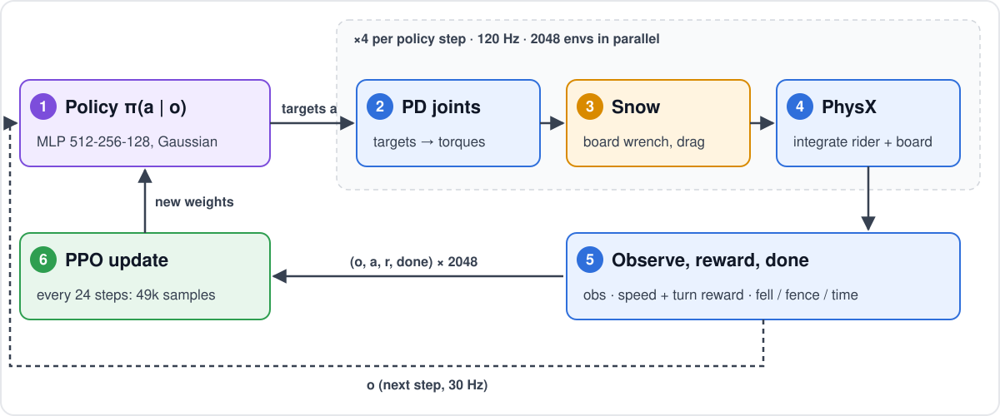
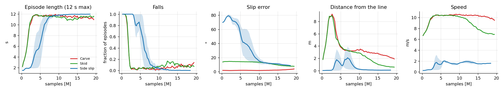

# RL training

One env (`playground/snowboard/env.py`) teaches three tasks with plain **PPO** (`skrl`): **side slip**, **skid**
and **carve**. There's no demonstration and no style reward yet; the policy learns from task rewards alone. Knobs:
`SnowboardEnvCfg` (`--set key=value`), `playground/snowboard/ppo.yaml`. SI units; angles in rad unless marked °.

## 1. The task: learn the turn

**No line is laid on the snow.** The turn tasks command a **speed** and reward **linked turns**. On a slope, the
only way to hold a speed below the straight-run speed is to turn across the hill, so the S (its length, its width,
its rhythm) is *learned*: it comes out of the physics of speed, slope, edge angle and grip.

| Task | Heading | Slip target $\beta^*$ | Track on the snow |
|---|---|---|---|
| Side slip | Straight down the fall line | $-90°$ (heel edge) | Wide straight band |
| Skid | **Free**: linked turns | $20°$ (the board pivots and slides) | Wide S |
| Carve | **Free**: linked turns | $0$ (clean edge) | Thin S |

| Quantity | Definition |
|---|---|
| Path heading | $\psi = \operatorname{atan2}(v_y, v_x)$: travel direction, 0 = straight down the fall line |
| Slip angle | $\beta = \operatorname{atan2}(v_\perp, v_\parallel)$: angle between the board's axis and its travel |
| **Linked turn** | $\psi$ crosses the fall line after swinging $\lvert\psi\rvert \ge 80°$ to one side: a big fat S, each turn finished nearly across the hill |

**Why turns emerge.** Training runs on a **15° slope**. Going straight down it runs to ~24 m/s ([snow model §4](SNOW_MODEL.md)). Commanded
8–11 m/s and capped at 12 m/s, the rider must spend part of each turn heading across the hill, where gravity pulls less. How far across,
and how long each turn is, depends on speed, slope and how hard the edge can hold: the policy finds it.

**A guide to start from.** Learning to turn from nothing is slow, so the turn tasks begin with a guide S that the
policy traces, then fades out:

$$y_{\text{guide}}(x) = Y\sin\!\left(\frac{2\pi x}{\lambda} + \varphi\right),\quad Y = \frac{\lambda\tan A}{2\pi} \qquad A \sim U(35°, 50°),\ \varphi \in \{0, \pi\}$$

$\lambda$ is drawn per episode so the S stays carvable: tightest bend $\lambda / (2\pi\tan A) \ge 9$ m (sidecut 5–7 m),
swing $Y \le 15$ m (fences at ±20 m). The rider starts on the guide, heading along it, at 4–6 m/s.

The guide fades **adaptively**: only while the policy follows it.

| Mean guide heading error (all envs, running) | Guide strength (reward and observation) |
|---|---|
| < 15°: it's tracking | Fades, −1/3000 per step |
| > 30°: it lost it | Comes back, +1/3000 per step |
| between | Holds |

Once the strength reaches 0, turn length, width, rhythm and how to press are the policy's own. A fixed schedule
(fade over the first half of training) failed: the guide was gone before the policy could ride well enough to
follow it.

Each episode draws its own S, so no single shape is learned. Play and evaluation always run with the guide off.

## 2. MDP

| | |
|---|---|
| **Observation** | Humanoid: joint positions and velocities, torso height, orientation, velocities, hands and feet relative to the root (AMP layout) |
| | Board: $\theta$, $v_\parallel$, $v_\perp$, yaw rate, $N / mg$, grip usage $\lvert F_\perp\rvert / \mu N$ (+ two-half board: nose and tail edge angles, load on the nose, camber flattened) |
| | Last action |
| | Task (16): speed and command, $\psi$, $\beta$, board yaw, position between the fences, turn side, swing so far, time since the last turn, $\beta^*$, guide heading error and fade |
| **Action** | Joint targets around the stance (see [humanoid model §5](HUMANOID_MODEL.md#5-actions--joint-targets)), 30 Hz |
| **Done** | **Fell**: pelvis below 0.20 m above the snow, or torso tilted > 80° from the snow normal, or pelvis < 0.12 m above the board, or the board past 85° of edge (on its side): room for the deep carves in `reference-image/`, not for lying down. **Fence**: board past ±20 m. Or 12 s (**time-out**) |
| **Start** | Side slip: at rest on the heel edge, CoM above it. Turns: piste centre, heading within ±20° of the fall line, at the commanded speed |

| Model | DoF (actuated) | Observation | Action |
|---|---|---|---|
| Baseline rider, rigid board | 28 | 131 | 28 |
| New rider, two-half board | 30 (+2 passive board) | 145 | 30 |
| Aggressive-carve rider (boots, knee twist, passive ankles / neck / knee twist) | 34 (21 actuated) | 140 | 21 |

## 3. Reward

**What a good run achieves, not how to move.** Each step, with $\Delta t = 1/30$ s:

$$r = \Delta t \sum_i w_i\, r_i \;+\; w_{\text{turn}}\,\mathbb{1}[\text{turn}] \;+\; w_{\text{fall}}\,\mathbb{1}[\text{fall or fence}]$$

| Term | $r_i$ | $w_i$ |
|---|---|---|
| Alive | 1 while up | 1.0 |
| **Speed** | $\exp\!\big(-((\lVert v\rVert - v^*)/5)^2\big)$, $v^* \sim U(8, 11)$ m/s | 2.0 |
| **Speed cap** | $\operatorname{clip}\big((\lVert v\rVert - 12)/2,\ 0,\ 1\big)$: forces turns finished across the hill | −3.0 |
| **Carve** | $\underbrace{\operatorname{clip}(\lvert\theta\rvert/40°)}_{\text{edged}} \cdot \underbrace{\operatorname{clip}(\lvert\dot\psi_{\text{board}}\rvert/0.5\text{ rad/s})}_{\text{turning}} \cdot \underbrace{e^{-(\beta/15°)^2}}_{\text{clean}} \cdot (0.5 + 0.5\,\text{low})$: full at 40° and up | 2.0 |
| **Low** | Pelvis above the board, always: ramps from 0 at the 0.80 m stance to full at 0.45 m (full to 0.30 m), never lie down (0 at 0.15 m) | 1.0 |
| **Turn** | At each fall-line crossing: $\operatorname{clip}\big((\text{swing} - 30°)/(85° - 30°),\ 0,\ 1\big)$: deeper turns pay more, full at 85° | 1.0 |
| **Fall** | Once, a fall or a fence | −10 |
| Guide | $e^{-((\psi - \psi_{\text{guide}})/30°)^2}$ × adaptive fade | 4.0 → 0 |
| Action rate | $\lVert a_t - a_{t-1} \rVert^2$ | −0.01 |

**A good carve** = low, steep edge, no skid, turns finished nearly across the hill: that is the reward, and nothing
else. Edged, turning and clean multiply in one carve term: tipped but riding straight, turning on a flat board, or
skidding each earn about nothing. Low is rewarded throughout (a rider never stands up fully) and counts double while
carving. The rest of the technique (which way the chest faces, angulation, how hard to press when) is **not
rewarded**: if a 40° carve needs it, the policy finds it, or a style reward learned from a real rider (Stage 3's AMP)
adds it. An earlier version had 17 terms, including upright, low, facing, angulation and pose; it hand-designed the
technique, its terms fought each other (pose pulled toward the stance, low pulled away), and each one was gamed.

**Fewer actions.** Boots (ankles), neck and knee twist are left **passive** (`passive_joints`): still in the physics,
held by their drives at the stance target, but not driven by the policy. 21 actions instead of 32: hips 6, knee
flexion 2, spine 5, arms 8.

**Lessons from the reward (each one cost a training run):**

| Try | What happened | Fix |
|---|---|---|
| Speed Gaussian only, $\sigma$ = 2 m/s | Rode straight at 15 m/s (command 5–9): at 8 m/s over, $e^{-16} \approx 0$, no gradient toward slowing | $\sigma$ = 5 m/s + an over-speed term |
| Over-speed unbounded, $-0.5\,(v - v^*)$ | The rider speeds up through each episode, so late seconds cost more than staying up earns: it learned to **fall at ~5 s** | Penalties bounded (a second alive is worth ≥ 0) + a −10 fall penalty |
| Guide S of 25–60 m at 30–55° | Asked for 2.8 m bends, tighter than any carve: riders threw themselves at it | Guide ranges kept carvable |
| Speed command 5–9 m/s on 15°, mild cap | Rode straight at the 15 m/s cap, ignored the guide: the cap cost at most 1/s, less than staying up earned | Rider starts on the guide; guide line term |
| Start at 11–15 m/s on the guide | 77–98% of episodes ended at a fence in ~2.5 s: 8–10 m/s sideways, no time to learn the first turn | Start at 4–6 m/s; **cap 12 m/s at −3/s**, fall −30 |
| Cap 12 m/s, fall −30 | Learned to **ride flat**: edge angle 18° → 4°, straight at 13 m/s taking the cap penalty. No edge, no sidecut turn; −30 made trying to edge too costly | **Edge reward**; fall −10; guide weight 4 |
| A turn = a 15° swing | Learned to turn (edge 17–19°, 0 falls) but **gamed the turn bonus**: ±15° wiggles every 0.7 s (14–16 "turns" per 10 s), still 5 m/s over the command | A turn needs a **45°** swing |
| Guide faded on a fixed schedule | Every try: the guide was gone before the policy could ride, so the turn was never learned (baseline: 0 real turns at 70%) | **Adaptive guide**: fades only while followed |
| Low always rewarded; fall = pelvis below 0.45 m only | **Lay on the snow with the board on its side** (edge 70–100°, pelvis 0–0.2 m above the board) and **spun in place** at 2.6 m/s for carve and turn reward; the fall check never fired | Falls also catch lying (torso > 80°), sitting (< 0.12 m) and a board on its side (> 85°); carve and turns need speed (> 4–5 m/s) |
| Edge + angulation + low, ungated | **Leaned back onto the heel edge** (65° edge, pelvis 0.4 m, body near horizontal) and rode a straight diagonal into the fence: full edge, angulation and low reward, no turn | Edge and angulation pay only while the board turns; low has a floor |

## 4. PPO

| Setting | Value |
|---|---|
| Envs | 2048 in parallel |
| Rollout | 24 steps × 2048 = **49k samples per update** |
| Update | 5 epochs × 4 mini-batches |
| Training | 12 000 steps per env = **24.6M samples**, 500 updates (~30 min alone on an L40S) |
| Networks | Policy and value: separate MLPs, 512-256-128, ELU |
| Policy | Gaussian, initial $\sigma_a = e^{-1} \approx 0.37$ (bigger flails throw the bound rider) |
| Discount, GAE | $\gamma = 0.99$, $\lambda_{\text{GAE}} = 0.95$ |
| Learning rate | $10^{-3}$, KL-adaptive (target KL 0.01) |
| Clipping | Ratio 0.2, value 0.2, grad norm 1.0 |
| Entropy bonus | 0.01 |
| Normalisation | Running mean/std on observations and values |
| Time-outs | Bootstrapped (a time-out is not a failure) |

## 5. Evaluation (`playground/snowboard/play.py`)

A deterministic policy (mean action) rides **fixed, repeatable runs**: same start (piste centre, straight down),
middle of the speed range, 100 m long (25 m for side slip). Each run prints turns and metres per turn. Each run prints one line of stats, and the longest one is saved
as `trail.png` + `ride.csv`. `--record` films it for the README.

**Signs of a good carve** (`scripts/eval_runs.py`): low is rewarded; these are only measured, to see whether they
emerge.

| Sign | Metric |
|---|---|
| Quick edge change | `edge_change_s`: time from 20° on one edge to 20° on the other |
| Above a certain speed | `speed_err` against the 8–11 m/s command |
| Press in the turn, release at the edge change | `press_turn` vs `press_change`: load $N/mg$ while turning hard vs while flat |
| Facing forward, shoulders open | `facing`: chest toward the travel direction (cos) |
| Hips folded, never fully released | `hip_flex_deg` (mean) and `hip_flex_min_deg` (least folded) |

## 6. Learning curves (baseline)

*Baseline, seed 1 (side slip: seeds 1–2), stopped at ~70% of training to switch to the new rider model.*

| Task | Falls | Slip error | Distance from line | Speed (target) |
|---|---|---|---|---|
| Carve | 11% | 3.3° | 2.1 m | 9.8 m/s (4–7) |
| Skid | 7% | 7.7° | 0.6 m | 7.0 m/s (4–7) |
| Side slip | 0% | 9.1° | 0.1 m | 1.6 m/s (0.5–2.5) |

**Reading the curves:**
- **Staying up comes first.** Falls drop from 100% to ~5% within 3M samples (side slip: 10M).
- **Line tracking comes second.** Turn tasks first ride straight and drift 9 m off the line, then learn to turn.
- **The carve can't slow down.** It holds 10 m/s against a 4–7 m/s command: on this slope and line, a clean carve
  settles at ~17 m/s and can only hold the tightest bend up to ~11.6 m/s, so it brakes by skidding a little
  (slip error rises late in training).
