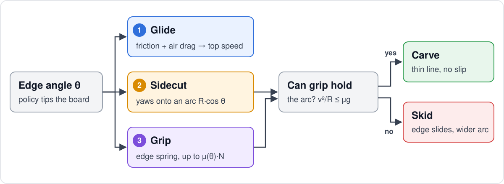
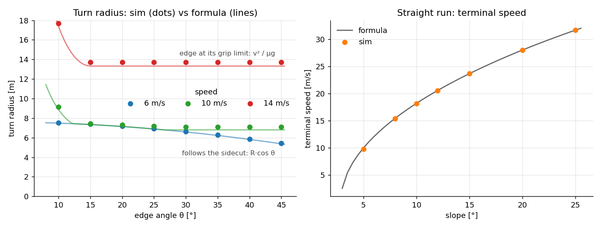

# Snow model

PhysX friction is isotropic, so a board on it can't carve. `envs/snow.py` replaces it with three forces applied
to the board each physics step (120 Hz): **glide**, **sidecut steering** and **edge grip**. Pure torch, batched over
envs. Knobs: `envs/physical.yaml` → `snow`, `board`. SI units; angles in rad unless marked °.

Driven alone, the model matches closed-form physics: **turn radius within 3%**, **terminal speed within 0.2 m/s**.

The policy never steers the board. It moves its body, the body tips the board to an edge angle $\theta$, and the
snow does the rest.

## Inputs

| Symbol | Meaning |
|---|---|
| $\theta$ | Edge angle: board roll relative to the snow surface |
| $v_\parallel,\ v_\perp$ | Board velocity along / across its long axis |
| $\omega$ | Board yaw rate about the snow normal |
| $N$ | Normal force on the board |
| $m$ | Rider + board mass |

## 1. Glide

$$F_\parallel = -\mu_g N \tanh\!\left(\frac{v_\parallel}{0.1}\right) \qquad F_{\text{drag}} = -\tfrac{1}{2}\rho\, C_dA\, \lVert v \rVert\, v$$

Glide acts on the board. Drag acts on the rider's pelvis: through the feet it would pitch the rider forward.

## 2. Sidecut steering

On edge, the board yaws onto the arc its sidecut cuts, unless that arc needs more grip than the edge has:

$$R(\theta) = R_{sc}\cos\theta \qquad \omega^* = -\mathrm{sign}(\theta)\,\frac{v_\parallel}{R(\theta)}\cdot h \qquad h = \min\!\left(1,\ \frac{\mu(\theta)\,N/m}{v_\parallel^2 / R(\theta)}\right)$$

$$\tau = \mathrm{clip}\!\left(k_\omega(\omega^* - \omega),\ \pm\,\mu(\theta)\,N\,\frac{L}{4}\right)$$

- $h < 1$: the arc needs more than the edge can hold, so the turn opens to radius $v^2 / (\mu g)$.
- $|\theta| < 3°$: no steering ($\omega^* = 0$). A flat board still resists pivoting, up to the friction torque.

## 3. Edge grip

A stick-slip ("bristle") spring at the biting edge, with $z$ its deflection carried between steps:

$$z_{t} = z_{t-1} + v_\perp\,\Delta t \qquad F_\perp = \mathrm{clip}\!\left(-(k\,z_t + c\,v_\perp),\ \pm\,\mu(\theta)\,N\right)$$

$$\mu(\theta) = \mu_{\text{flat}} + (\mu_{\text{edge}} - \mu_{\text{flat}})\cdot\mathrm{smoothstep}\!\left(\frac{|\theta|}{15°}\right)$$

$$\textbf{carve: } |F_\perp| < \mu(\theta) N \qquad\qquad \textbf{skid: } |F_\perp| = \mu(\theta) N$$

A spring, not a hard constraint: cancelling the slip in one step ($k \approx m/\Delta t$) shakes the light board end
(~7 kg) and topples the rider.

## Parameters

| Parameter | Value | Source |
|---|---|---|
| $R_{sc}$ | 7.6 m | Real board: 289 / 246 / 289 mm widths over a 1.14 m edge, $R \approx L^2 / 8d$ |
| $\mu_g$ | 0.05 | Waxed base on hardpack: 0.03–0.08 |
| $\mu_{\text{flat}} \to \mu_{\text{edge}}$ | 0.15 → 1.5 | Tuned: flat skids, edged holds ~1.5 g |
| $C_dA$, $\rho$ | 0.5 m², 1.0 kg/m³ | Upright rider, resort altitude |
| $k$, $c$ | $2\times10^4$ N/m, 800 N·s/m | Stable for the board end at 120 Hz |
| $k_\omega$, $L$ | 50 N·m·s, 1.14 m | Yaw gain, effective edge |
| $m$ | 67.7 kg | 65 kg rider + 2.7 kg board |

## 4. Validation (`scripts/validate_snow.py`)

A planar rigid board of mass $m$ is driven by the snow model alone (no humanoid, no Isaac Sim) and compared
against closed form:

$$R = \max\!\left(R_{sc}\cos\theta,\ \frac{v^2}{\mu(\theta)\,g}\right) \qquad v_{\text{term}} = \sqrt{\frac{2mg\,(\sin\alpha - \mu_g\cos\alpha)}{\rho\, C_dA}}$$

| Check | Sim / formula |
|---|---|
| **Slow turn follows the sidecut** (6 m/s) | 7.5 / 7.5 m at 10°, 5.4 / 5.4 m at 45° |
| **Fast turn opens at the grip limit** (14 m/s) | 13.7 / 13.3 m, any $\theta \ge 15°$ |
| **Carve → skid transition** (10 m/s) | Follows $R_{sc}\cos\theta$ to ~25°, then flat at $v^2/\mu g$ |
| **Terminal speed** | 18.2 / 18.2 m/s on 10°, 23.6 / 23.6 m/s on 15° |

`tests/test_snow.py` pins the same behaviour, plus signs and edge cases (a flat board doesn't steer, an airborne board
has no grip).

## 5. In the trained carve

The demo rides the **rigid board** (`board_flex` off). Measured from the longest eval ride of each policy, on
samples with $\lvert\theta\rvert > 15°$:

| Ride | Speed | Path turn rate ÷ sidecut prediction $v / (R_{sc}\cos\theta)$ | Slip |
|---|---|---|---|
| Stage 2 (7° slope) | 4.5–7 m/s | **1.05** (median): the board follows its sidecut arc | — |
| Stage 3, the demo (9° slope) | 4.5–10.7 m/s, mean 7.9 | **0.63** (median): turns wider than the sidecut arc | 2.5° mean |

The board doesn't skid in either (slip stays small): in the demo the turn opens through the steering cap $h$ instead.
Only ~20% of its edged samples are grip-limited by the steady-state estimate $v^2 / (\mu g) > R_{sc}\cos\theta$; the
rest of the gap is likely the load dropping through the edge changes (lower $N$, lower $h$) and the yaw-torque cap,
not isolated yet.

Even at full sidecut, turn sharpness is set by $R_{sc}\cos\theta$, which shrinks slowly with edge angle: 7.1 m at
20°, 5.8 m at 40°, 3.8 m at 60°. A 40° carve turns only ~20% tighter than a 20° one. Sharper turns at high edge angles
need the two-half board's progressive sidecut and flex.

## Not modelled

| Left out | Effect |
|---|---|
| Progressive sidecut, flex, camber, torsion | One rigid board. **Modelled** with the two-half board (`board_flex=true`): see [board model §4](BOARD_MODEL.md#4-two-half-board-opt-in-not-used-in-the-demo) |
| Snow conditions | One groomed hardpack: no powder, ice or ruts |
| Terrain | Physics is one tilted plane; the mountain is visual only. Everything is in the slope frame, so tilted terrain and tilted gravity give identical results |
